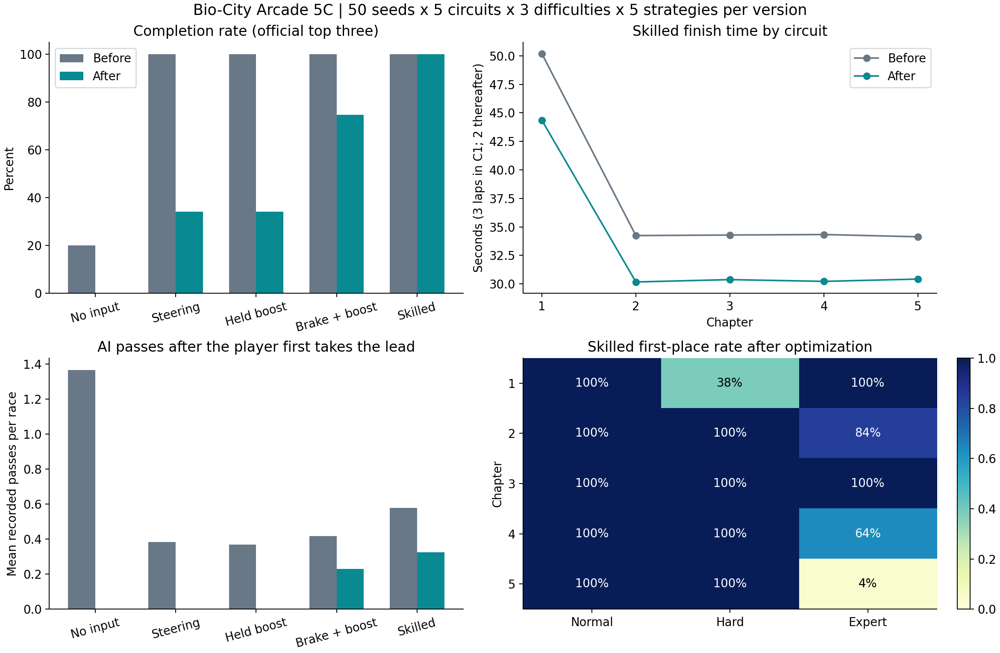

# 第 5C 批｜G06 競速錦標賽與視覺整合

- 規格：[Issue #24](https://github.com/squallorc-dot/fun/issues/24)
- 整合審查：[PR #25](https://github.com/squallorc-dot/fun/pull/25)，分支 `feat/g06-racing-championship`
- 正式基準：`8314ab5fa290b3f921a2e1a16cad590f74d064a7`。接續 `0602e1c`、`958a67b`、`996501e`，沒有從 main 重做或覆蓋既有成果。
- 本地驗收與證據整理完成；最終 GitHub 六項 CI、對應 HEAD 與待審狀態以 [PR #25 Checks](https://github.com/squallorc-dot/fun/pull/25/checks) 為可追溯紀錄，僅全數成功後解除草稿。沒有合併、部署或開始好友連線。

## 1. 範圍與保留項目

本批更動集中於 `games-core.js` 的 G06、`race-cup.js`、G06 所需的共用闖關介面、雙語指南與驗證工具。G01～G05 引擎在 `R.g06=env=>` 之前的內容與基準逐位元相同；G02 防衛戰引擎及 G05 桌球視角沒有改動。

六款遊戲、七守護者、五章路線、120Hz 固定物理、原有觸控配置、OST／音效設定、七英雄 2x 圖集、粒子、場景動態及原始畫布解析度都保留。七種車殼是專案內原創 Canvas 程序繪製，沒有使用網路圖片、付費服務或大型 3D 引擎。

## 2. 道路、近裁切、坡頂與攝影機

已實際重現第五章 `progress=1012.25`：世界路段 `1008` 的中心端點在 near plane 後，但路面邊角仍投影至 960×540 畫布下緣約 `y=528～539`。舊 `visibleStrips` 因中心點無效跳過整段，會遺失仍可見的路面。以 0.25 距離掃描找到第五章 45 個同類位置；沒有因此推論其他章也發生相同錯誤。

修正方式：

1. 先在攝影機空間裁切路肩多邊形，再以裁切後的面向與範圍判斷可見性；中心點不能決定整片路面消失。
2. 地形外側保留真實深度並整片裁切，移除只夾住深度、卻留下不相符高度的投影方式。
3. 路面、地形、護欄及對手共用坡頂深度遮罩，避免遠方路面或物件穿過前方坡頂。
4. 保留五條封閉世界座標賽道、S 彎、坡度與輪胎 `0.82 × 畫布高度` 接地錨點。
5. 過彎相機側偏隨車速淡出；煞停時清除殘留側向速度，煞車也能固定停在下坡。舊測試對停車後 `roadSample` 使用完全相等斷言，沒有改成寬鬆誤差。

`test-g06-projection.cjs` 覆蓋五章、兩種邏輯視窗各 1,000 個位置，共 **10,000 姿態／40,001 檢查**，另有原有 360／1,000 幾何與攝影機樣本。原效能測試保留 240 個精確投影雜湊及原呼叫數門檻；因本次修正有意改變投影，使用新的 `batch5c-projection-golden-20261028.json`，歷史 fixture 留存。

### 可人工檢視的連續證據

[連續畫面驗收頁](../qa/20261028-racing/index.html) 提供前後並排播放：每版五章 × 桌面 1440×900、手機直向 390×844、橫向 844×390，**各 15 段／568 影格**。第五章桌面段包含 `1012.25` 的近端錯誤，其他段依實際路線選取坡頂、下坡與高曲率位置。每格保留種子 7、進度、速度、邏輯畫布、攝影機、輪胎與可見路段資料；全部檢查實際路面／車體像素，避免空畫布截圖冒充證據。

這些路段影片是正式渲染器的相同姿態重播，使用僅存在測試 HTTP 回應的擺位鉤子，**不能當作真實完賽或 AI 行為證據**。六車競爭另有普通控制輸入完成前四章後、繼承排位的完整第五章影片與逐格六車資料，沒有設定位置、生命、名次或勝利。該示範明示在第 5 秒使用一次 0.2 秒煞車失誤，再恢復熟練控制，以驗證被超越後的追趕；原完美控制的種子 7 首位起跑會保持領先，不應為影片強迫 AI 必定超車。示範保存完整輸入帶，常態追擊頻率另由 50 種子矩陣衡量。影片匯出保留原尺寸、全部 12fps 影格，採 VP9 CQ18；原始道路錄製為 lossless，正式遊戲畫質沒有調降。

## 3. 六車物理、AI 與氮氣

舊問題來自玩家過彎代價與 AI 過度保守減速的組合，不能只用增加障礙或強制排名補救。六車現在使用同一個 `drive`／接地抓地、路肩耗損、碰撞保護與檢查點限制；受撞保護期間仍解算速度，不能穿車。AI 的路線選擇由同時刻六車快照決定，沒有讀玩家排名或差距決定額外動力，也沒有瞬移、種子分支或無輸入判輸機制。

玩家自動巡航 82、氮氣目標 96、加速度 16；AI 保留五種駕駛風格、不同加速度與路線偏好。高速超出彎道輪胎範圍時，六車同樣承受抓地下降、側滑與輪胎減速。煞車減速度 38，錯誤入彎、回正與重新加速會影響名次。起跑前四秒保留各自實際格位的路線，避免不合理的雙側夾撞；接近檢查點時 AI 也必須回到合法範圍。

恢復三個提交後的首輪矩陣曾出現熟練控制器 750 場全部奪冠，因此沒有直接視為交付完成。進一步確認 AI 將遠方彎道的限速立即套用在目前速度，提早收油，也壓縮氮氣時機。最終改以各預覽點的距離與 `sqrt(入彎速度² + 2 × 煞車預算 × 距離)` 計算接近速度；風格預算 22／25／28，均低於共用物理煞車上限 38。一般／進階／專家維持不同安全餘量，沒有更改各車巡航上限或依排名補速。

第四章具體回歸：AI 在 `z=87`、速度 86 接近遠方彎道，舊提交目標速度約 82.47、已煞車；最終可維持 86，到了 `z=174` 才確實將目標降至約 80.83 並煞車。新增斷言與完整 50 種子矩陣共同驗證，避免只為一個畫面或種子安排勝負。

氮氣消耗每秒 27，側滑加重消耗；一般回充每秒 8、尾流回充 18，啟動至少 25、冷卻 1.2 秒。空槽後須放開再按，持續按住不能自動重啟；AI 使用相同啟動條件與耗能，按路況安排脈衝。尾流與氮氣有實際速度效果，過彎時機錯誤會抵消收益。

### 種子 7 的因果對照

見 [原始結果 JSON](v1.5/batch5c-seed7-idle-20261028.json)，三版皆正常起跑、第五章專家、零輸入、120Hz：

| 版本 | 實際起點 | 結果 |
| --- | --- | --- |
| main `8314ab5` | 距離 0、車道 0、第 6 | 第 3 完賽，35.618 秒，誤成可通關路線 |
| 共用物理 `958a67b`，仍使用舊起跑方式 | 距離 0、車道 0、第 6 | 第 6、DNF，未清完檢查點 |
| 最終整合 | 距離 0、車道 0.6、第 6 | 第 6、DNF，未清完檢查點 |

第二列隔離出物理修正的效果，避免把新起跑車道誤認為唯一原因。失敗由實際偏離路面、碰撞及生命耗盡產生，沒有檢查玩家是否按鍵。

## 4. 50 種子平衡分析

每版 **50 固定種子 × 五章 × 三難度 × 五策略 = 3,750 場**，前後共 **7,500 場真實引擎賽事**。策略為空輸入、基礎轉向、基礎轉向＋氮氣長按、保守煞車＋氮氣、熟練競速。物理 120Hz、控制 20Hz、最長 180 模擬秒，未結算會直接失敗。所有版本使用同一份控制器與種子；舊版僅增加唯讀路線預覽與診斷橋接，沒有改舊版物理或結果。

熟練控制器能精確讀取路線預覽與車輛狀態，因此是可行性上限，不能視為一般玩家勝率；手機也不是用這個控制器進行真人手感驗收。每章三難度各 50 場完整結果、碰撞、超車、領先後被追過／再超回、AI–AI 超車與氮氣消耗，都保留在壓縮原始資料。

| 策略（每版各 750 場） | 通關率：前 → 後 | 奪冠率：前 → 後 | 平均名次：前 → 後 | 氮氣使用秒：前 → 後 |
| --- | --- | --- | --- | --- |
| 空輸入 | 20.0% → 0.0% | 7.3% → 0.0% | 5.201 → 6.000 | 0.000 → 0.000 |
| 基礎轉向 | 100.0% → 34.1% | 60.5% → 0.0% | 1.525 → 3.944 | 0.000 → 0.000 |
| 轉向＋長按氮氣 | 100.0% → 34.1% | 61.7% → 0.0% | 1.516 → 3.944 | 16.564 → 3.700 |
| 保守煞車＋氮氣 | 100.0% → 74.7% | 75.9% → 15.9% | 1.247 → 2.608 | 6.087 → 4.959 |
| 熟練競速 | 100.0% → 100.0% | 76.0% → 86.0% | 1.240 → 1.140 | 15.423 → 8.599 |

| 策略 | 碰撞：前 → 後 | 玩家超車：前 → 後 | 首次領先後被追過：前 → 後 | 再超回：前 → 後 | AI–AI 超車：前 → 後 |
| --- | --- | --- | --- | --- | --- |
| 空輸入 | 4.159 → 2.729 | 4.637 → 0.933 | 1.365 → 0.000 | 0.109 → 0.000 | 6.283 → 5.569 |
| 基礎轉向 | 1.007 → 2.537 | 5.960 → 3.993 | 0.383 → 0.000 | 0.367 → 0.000 | 6.341 → 6.289 |
| 轉向＋長按氮氣 | 1.028 → 2.537 | 5.939 → 3.993 | 0.368 → 0.000 | 0.357 → 0.000 | 6.331 → 6.289 |
| 保守煞車＋氮氣 | 1.032 → 2.739 | 5.728 → 4.577 | 0.417 → 0.229 | 0.244 → 0.171 | 6.236 → 6.228 |
| 熟練競速 | 2.360 → 2.863 | 5.365 → 5.239 | 0.579 → 0.324 | 0.359 → 0.263 | 6.467 → 6.351 |

上表為每場平均事件數，並非每個指標都改善；未曾領先的場次，其「首次領先後被追過」為 0，不能把 0 解讀成對手不會追擊。熟練策略領先後被追過的平均次數低於 main；玩家巡航與共同物理同時改變，不能單靠這個數字宣稱追擊全面提高。相較恢復前三提交時的 0.087 次與全數奪冠，最終為 0.324 次、14% 熟練賽事由 AI 奪冠。AI 追擊不保證每場發生，對手也不按玩家名次補速。第四、第五章空操作共 300 場均未登台；一般保守操作各章通關率 94～100%。前後兩版各自 18,750 台 AI 在本矩陣都實際完賽，沒有靠 timeout 製造 AI 分類。

熟練策略每組 50 場（欄位依序為通關率／奪冠率／平均完賽秒）：

| 章節 | 一般 | 進階 | 專家 |
| --- | --- | --- | --- |
| 1 | 100% / 100% / 44.327 | 100% / 38% / 44.689 | 100% / 100% / 44.046 |
| 2 | 100% / 100% / 30.142 | 100% / 100% / 30.257 | 100% / 84% / 30.127 |
| 3 | 100% / 100% / 30.392 | 100% / 100% / 30.471 | 100% / 100% / 30.277 |
| 4 | 100% / 100% / 30.191 | 100% / 100% / 30.181 | 100% / 64% / 30.308 |
| 5 | 100% / 100% / 30.526 | 100% / 100% / 30.385 | 100% / 4% / 30.372 |

第一章三圈、後四章各兩圈，不能直接拿章與章的總時間比較圈速。第五章專家熟練控制的奪冠率只有 4%，仍可全部前三通關；這是需要真人確認的高挑戰區間，沒有宣稱容易奪冠。



原始統計：[修改前](v1.5/batch5c-balance-before-20261028.json)、[修改後](v1.5/batch5c-balance-after-20261028.json)、[各 AI 分圈與速度](v1.5/batch5c-ai-profiles-20261028.json)。各摘要的 `rawSamples` 指向實際 3,750 場 gzip JSON，含每場完整分類；AI 圈時來自實際跨線，速度每秒採樣並含完賽後等待其他車的減速，彎道進出速度是採樣閾值事件，不能冒稱精確彎心測速。

`test-g06-balance.cjs` 在 CI 重跑全部 3,750 場，並非只信任文件：第四／五章空輸入不登台；熟練策略各組有可行路線且每章專家存在奪冠；一般保守策略可通關；長按氮氣不能近乎保證通關；保留真實追擊、AI–AI 超車、再超回事件及六車完整有限結算。

## 5. 實際起跑排位與獨立錦標賽

預設第一章與快速遊玩第 6 起跑。格位距離為 `[24,20,16,12,8,0]`、車道交錯 `-0.6/+0.6`，六車皆重排世界座標。下一章六車順序完全繼承上一章正式分類；玩家前一場第 1／2／3，下一場即取得對應實際格位。起跑先建立六車相對順序，排位不計成超車。

新鍵為 `bio_arcade_g06_cup_v1_<基礎難度>_<英雄>`，不含語言。每輪五章依序記錄六車分類、起跑格位、玩家名次、時間、最佳圈與超車；按 1～6 名配 **10／8／6／4／2／1** 分，每章合計 31、五章 155。總排名依積分、分站冠軍數、總時間、最近一站名次、穩定車手 ID 排序；DNF 在時間決勝中使用明訂的大額時間懲罰，不偽造完賽時間。

| 情境 | 規則 |
| --- | --- |
| 第 4～6 或 DNF | 不新增錦標賽回合、不跳章，原章原格位重試 |
| 重玩已完成章節 | 保留首筆正式錦標賽成績，不能重複加積分；既有合法勝場仍照原規則記錄 |
| 快速遊玩 | 獨立第 6 格，不讀寫本輪積分 |
| 舊存檔已解鎖後章 | 舊解鎖、最高分、勝場保留；新錦標賽從第一章依序，仍可選已解鎖章節練習 |
| 回大廳／重新整理／切語言 | 同英雄與基礎難度恢復同輪下一個合法章節與實際格位 |
| 換英雄／基礎難度 | 各自獨立錦標賽，切回可恢復原輪；既有章節難度遞增規則保留 |
| 五章結束／開始新錦標賽 | 可展開六車五章總表；新輪只重置錦標賽積分與格位，舊闖關紀錄不清除 |
| 資料損毀 | 新錦標賽安全回復，舊 `bio_arcade_campaign_v11_*` 不動 |
| localStorage 拒絕／滿額／getter 拋錯 | 本分頁記憶體接續，明示暫存限制；關頁可能遺失 |
| 未支援的未來 schema | 不覆寫原 bytes，當前分頁使用暫存並提示 |

原 `{unlocked,best,wins}` 鍵及語意沒有改動，沒有重算歷史勝場。`finish` 的結果鎖、`record` 的順序／合法六車／格位驗證與首筆記錄共同防止重複結算。結算後外部 HUD 立即讀入新增積分，不再停留上一章數字。

## 6. 七款車身、HUD 與手機

七款程序車殼為烈焰 GT、共振機甲、鋼鐵越野、光子疾影、三重泡影、翠葉巡遊、先知星環。不同車頂、輪廓、車翼／備胎／泡影／葉片／星環等配件，搭配輪胎紋理、輪圈、煞車光、車身側傾、加減速俯仰、碰撞震動與氮氣尾焰。輪胎接地位置不隨車身震動漂移；七款共用 1.75 碰撞寬度及相同物理，另有同種子完整結果相等測試。

外部 HUD 顯示名次、圈數、檢查點、時間、氮氣、超車及積分；Canvas 保留速度、車款、小地圖、彎道／後車方向與前後差距，減少重複。距離由實際累計進度計算；秒差使用雙方通過同一檢查點的真實時間，明標「上個檢查點」，不是用距離除猜測速度。手機字體依 CSS 顯示比例放大，車距至少 10.5 CSS px，沒有縮小世界或降低 DPR。

繁中／日文均有起跑順位、下章提示、積分表、失去抓地與氮氣放開再按提示。錦標賽表可展開、文字換行，結果按鈕保留可操作空間。[七款實際畫面與六組雙語結算](../qa/20261028-racing/index.html) 同時提供程式車款資料與實際渲染截圖。

## 7. main 圖片解碼 CI 失敗：證據與界線

正式 main run [40540147459](https://github.com/squallorc-dot/fun/actions/runs/40540147459)，job `122316022925` 的原始 [Checks annotations](v1.5/batch5c-main-ci-failure-20261028.json) 記錄：

```text
page.evaluate: EncodingError: The source image cannot be decoded.
scripts/smoke-arcade-art.mjs:30:25
Node.js v20.20.2
```

發生在 48 場景檢查之後、七英雄 2x 圖集稽核的獨立 `new Image().decode()`。測試原先將七張大型影像及完整像素讀回放在同一頁迴圈；影像／像素資料生命週期累積是待查假說，**不是已證明的根因**。本地未重現同一個原始 EncodingError；完整 hosted log 的下載受環境 proxy 限制，保留可取得的原始 Checks 證據。

本批將每位英雄的稽核放到各自擁有的 browser page/context，完成即關閉，限制跨英雄資源生命週期；仍檢查原生 **2560×2880、全部 497 格、原 alpha 邊界、原 56.25 MiB cache 上限、缺圖回退**。沒有重試掩蓋、延長 timeout、刪除格數或停用效果。現在每位英雄後就保存 `atlas-audit.json`，失敗也保留英雄、解碼錯誤、cache 與圖片 HTTP／request failure 診斷。

隔離後本地與最終 CI 的通過，只能證明這次版本在相應環境完成同等檢查；不能宣稱原始 CI 偶發原因已排除。若再次出現，應依保存的診斷檢查 HTTP、檔案解碼與瀏覽器資源情況，不以重跑成功結案。

隔離後的本地 [逐英雄稽核資料](v1.5/batch5c-atlas-audit-20261028.json) 包含七頁、497 格與圖片 HTTP 回應。另一次本批 CI [40594006077](https://github.com/squallorc-dot/fun/actions/runs/40594006077) 的圖片步驟已通過，但新錄影步驟在 `recordDuel` 回報 `ffmpeg unavailable`，見 [保留的失敗日誌](v1.5/batch5c-recording-ci-failure-20261028.log)。本批因此明確安裝錄影所需 ffmpeg，並把啟動錯誤與有界 stderr 寫入 Checks annotation；沒有將這次失敗誤報為原圖片錯誤復發，也沒有略過影片測試。

## 8. 最終測試與重現

| 驗證 | 實際結果與覆蓋 |
| --- | --- |
| Node | 30 套（原 24＋本批 6）；恢復版完整執行，AI 預估修正後再驗相關引擎、路線、投影、存檔、效能、矩陣；最終 CI 在同一 HEAD 全套執行 |
| 50 種子 | 新版 3,750 場／7,613 檢查通過；舊版另重跑 3,750 場，與保存 baseline 的全部結果完全相同 |
| 原 G06 120 場 | 1,189 檢查通過，五章／三難度／種子 1、29／120、60、30、10 FPS；AI–AI 超車共 712 次 |
| 原 G06 108 場 | 12 種子 × 三難度 × 三幀率，九檢查點、同實例重試、完全停車與 360 相機樣本通過 |
| 投影 | 40,001 檢查／10,000 五章橫直向姿態通過 |
| 動力學 | 119 檢查／90 條同輸入帶，10、15、30、60、120、240 FPS 完整狀態一致；七車性能一致；遠彎不過早煞車、近彎確實煞車 |
| 錦標賽／排位／車款 HUD | 574／151／1,024 檢查通過，含全英雄、三基礎難度、五章、儲存例外、真實座標、煞停攝影機及 CSS 字體 |
| 六款玩法／存檔 | Node 868 檢查、105 真實通關、42 條 10～240 FPS 同輸入路線；原 260 玩法、176 存檔完整性檢查通過 |
| G02 裝置公平性 | 5,355 檢查／945 裝置與波次樣本，七英雄／五章／三難度，桌面 60、直向 15、橫向 10 FPS |
| Node 效能 | 3,242 檢查，810 真實引擎／FPS、126 G02、240 精確投影；原門檻保留 |
| 瀏覽器 | 原 14 套皆執行，含六遊戲雙語、OST、資源、操作、低幀率與本批擴充的闖關套件 |
| 真實五章介面 | 2,246 檢查、230 次真實通關，另兩次錦標賽實際敗北；210 個標準六遊戲／七模式／章節／難度／語言樣本，含手機橫直向與桌面；重試、重玩、換語言、quota/getter、五章新輪通過 |
| 操作矩陣 | 6,701 檢查／410 次實際啟動，雙語、七視窗、四配置、七模式；G02 手機另 3,378 檢查／60 次啟動 |
| 圖像／指南／音訊 | 資源美術 251 檢查／48 場景、七頁 497 高解析格；英雄 218／781 格、指南 1,398、音效 42、持續 OST 44 檢查通過 |
| 低幀率瀏覽器／G06 | 257／164 檢查通過；完整效果、實際按鍵與多配置，不用降低畫質換通過 |
| 連續畫面 | 前後各 15 段／568 影格；實際第五章 418 影格、四次玩家相關超車事件，含完整 20Hz 輸入帶 |

闖關套件的像素檢查依錄影影格逐格計數，因此總檢查數隨實際完賽片長變化；本次由舊錄影 424 格改為 418 格，沒有刪除或放寬原斷言。仍保留「AI 超越後玩家再次超回」斷言；指定一次普通煞車失誤，避免錯把「每場完美駕駛必須被超車」當成驗收條件。匯出時會清理測試擁有的舊 PNG 並限制本次完成格數，再由 ffprobe 核對尺寸與總格數，避免較長舊錄影的尾格混入。

最終六個 GitHub jobs 為 `verify`、`browser`、`arcade-engines`、`arcade-session-browser`、`arcade-controls-browser`、`arcade-performance-browser`。PR 的最新 HEAD Checks 與 PR 說明列出實際 run 連結；沒有把較早提交的五綠一紅或本地結果稱為最終 CI 通過。


原有 108 場路線／種子／三難度／三幀率／九檢查點／重試／完全停車斷言全部保留。因操控規則已加入真實抓地與煞車，通關控制器改用可煞車、選擇氮氣的普通輸入；原不煞車與氮氣長按策略仍完整列入 50 種子對照，沒有刪除失敗資料。120 場 AI 回歸與原接地、碰撞、圈數、幀率斷言也保留。

重現新證據（Node 20、Playwright 1.56.1、Chromium、ffmpeg；圖表另需 matplotlib）：

```sh
node scripts/test-g06-projection.cjs
node scripts/test-g06-dynamics.cjs
node scripts/test-g06-cup.cjs
node scripts/test-g06-grid.cjs
node scripts/test-g06-models-hud.cjs
node scripts/test-g06-balance.cjs
node scripts/probe-g06-seed7.cjs
node scripts/smoke-gameplay-campaign.mjs
node scripts/capture-g06-sequences.mjs
node scripts/curate-g06-proof.mjs
node scripts/export-g06-balance.cjs
python3 scripts/plot-g06-balance.py
```

基準對照用保留的 `8314ab5` 原始碼設定 `RACE_ROOT`、`RACE_LABEL=before` 執行 `analyze-g06-balance.cjs` 與 `capture-g06-sequences.mjs`。CI 每次重新執行正式引擎與瀏覽器測試，並上傳 balance、圖集稽核、連續影片與雙語結果，文件不取代 CI。

## 9. 未完成／仍需人工驗收

- Cloud Chromium 不是實體手機。iPhone Safari、Android Chrome、Windows Chrome／Edge 的觸控手感、輸入延遲、旋轉、長時間溫度／耗電及實際效能待驗收。
- AI 的競爭感、街機抓地與氮氣難度仍需真人測玩；控制器可行性與統計不保證每位玩家主觀滿意。
- 原 main 圖片偶發解碼失敗根因尚未確證，保留追蹤，不能把本次通過解讀為根因結案。
- 這是既有 Canvas／2.5D 的車款與投影改善，沒有宣稱提供完整 3D 車模或新高解析背景原稿。
- 依授權只更新原 PR；不合併 main、不發布正式網站、不開始第 6 批好友連線，等待正式驗收。
