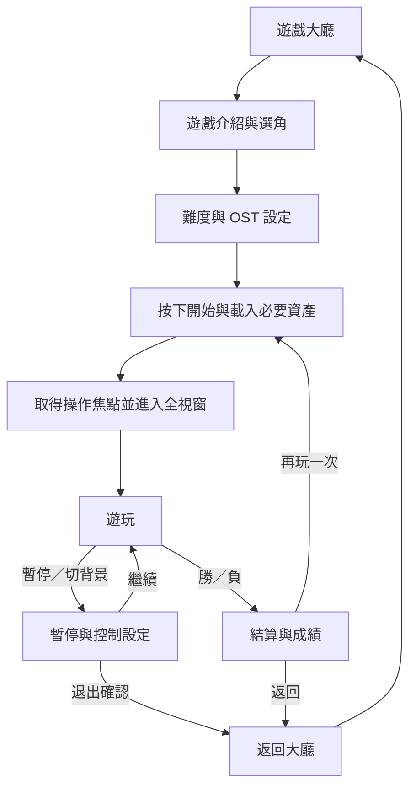

# Bio-City Arcade｜守護者遊戲宇宙：總體遊戲設計規格 GDD

**規格版本：** 0.3／2026-10-25　　**狀態：** 規劃／開發規格，非已完成的遊戲功能  
**正式網站：** https://squallorc-dot.github.io/fun/zh/play.html  
**程式庫：** https://github.com/squallorc-dot/fun  
**範圍：** 六款獨立遊戲、共通遊戲大廳、七組守護者、四首目前公開 OST、共用遊戲音訊系統、中日文、桌機與手機、成效事件、維護與驗收

> 原則：先做「完整可玩且有質感」的遊戲，再擴充關卡與英雄。六款遊戲玩法要有本質差異。不能以靜態 PNG 加幾何形狀冒充角色動畫；不能只換背景與分數規則而稱為不同遊戲。

## 1. 願景與不可變更的原則

- 品牌主線：Bio-City 生命之城；七組既有原創守護者；熵能軍團作為虛構反派。不得將遊戲情境描述為真實醫療診斷或保健功效證明。
- 新平台暫定命名 **Bio-City Arcade｜守護者遊戲中心**；六款遊戲採共同世界觀，但玩法、輸入、相機、物理和勝利條件獨立。
- 保留現有已可玩的城市防衛戰、8 題情境決策分析、英雄圖片、網站影音以及商品連結，不直接覆蓋或刪除。
- 不抄用 LF2、小朋友齊打交、彈珠超人、其他商業遊戲的人物、畫面、名稱、音效或關卡；參考的是遊戲類型及操作樂趣。
- 所有遊戲都有「可開始→可操作→可勝負→可重新挑戰」的完整迴圈，先通過基本可玩性測試才公開為可玩的正式入口。
- 遊戲不應把醫療或健康指標當作實際診斷分數；不蒐集問卷個別答案作為廣告定向資料。

## 2. 遊戲目錄與作品定位

| ID | 中文名稱（暫定） | 遊戲類型 | 核心樂趣 | 每局設計目標* | 操作核心 | 主要挑戰 |
|---|---|---|---|---|---|---|
| G01 | 守護者大亂鬥 | 2.5D 橫向清版動作／LF2 氛圍 | 連擊、擊退、反擊、Boss | 5–10 分鐘 | 移動／普攻／跳躍／閃避或防禦／技能 | 打擊感與角色動畫 |
| G02 | 城市防衛戰 | 俯視角即時射擊 | 走位、攻擊、技能、生存 | 3–6 分鐘 | 移動／射擊／閃避／技能 | 敵人波次與彈幕平衡 |
| G03 | 極限下樓梯 | 垂直平台反應生存 | 越往下越快、判斷安全落點 | 2–4 分鐘 | 左右移動／跳躍或下落 | 公平的隨機關卡生成 |
| G04 | 能源彈珠競技 | 蓄力彈射／反彈解謎 | 角度、力度、反彈、連鎖 | 2–5 分鐘 | 瞄準／蓄力／射擊 | 準確的反彈物理與關卡設計 |
| G05 | 能量競技場 | 排球主模式＋桌球副模式 | 預測球路、時機、攻守轉換 | 3–6 分鐘 | 移動／接球／擊球／蓄力 | 有手感且公平的 AI |
| G06 | 極速競賽 | 2.5D 擬 3D 競速 | 路線、甩尾、加速、避障 | 3–5 分鐘 | 左右控制／加速／剎車／技能 | 速度感與手機性能 |

*時間與內容為設計目標，並非已測得的實際遊戲時長。

### G01｜守護者大亂鬥（主力遊戲）

**玩法：** 側向清版格鬥，角色可上下移動於具有景深的地面平面；敵人從兩側進攻。與單一側視平台遊戲不同，加入站位深度、碰撞盒、打擊高度及前後景遮擋。先不做真正 3D 模型，以高品質 2D 人物動畫＋2.5D 場景達成效果。

- 操作：桌面 WASD／方向鍵移動、J 普攻、K 跳躍、L 閃避或防禦、U 專屬技能；可選擇替代鍵位。手機左側虛擬方向控制，右側攻擊、跳躍、閃避、技能；按鈕大小與配置可調。
- 戰鬥：至少三段普攻、方向衍生攻擊、受擊僵直、擊退、倒地與起身保護、無敵幀（閃避）、技能冷卻、敵方攻擊前搖。強攻與輕攻後續才加入，不在第一個切片把操作複雜化。
- 關卡：第一座城市街道（教學及雜兵）→ 交通能源區（群體戰）→ 城市核心（Boss）。每章有檢查點，失敗重試不必從頭全部重玩。
- 敵人 AI：巡邏、接近、攻擊預告、追擊、後撤與包抄。Boss 至少三種可學習的攻擊模式，血量降低時切換節奏，但不無理加快。
- 英雄差異：Burner 姐連擊型；MJ 機器人遠程控場；萌牛阿哞防禦反擊；葉寶 EX 高機動；果凍三兄妹協同分身；野菜小將補給與盾；Oracle 範圍魔法控制。初版先精製三位，正式完成再擴至七位。
- 美術：每個英雄至少 idle、walk/run、jump、attack1/2/3、hurt、dodge、skill、KO 等動作；碰撞盒與攻擊盒獨立於圖片實際尺寸。角色尺寸、腳底定位與動畫朝向統一。
- 首個完成標準：一位可操作英雄、一段 3 分鐘以上的關卡、三種敵人與 Boss、攻擊連段及完整重試機制；操作手感確認後再擴充。

### G02｜守護者城市防衛戰（既有資產升級）

**保留目前可玩版**：已有七組選角、三波敵人、Boss、難度、鍵盤與手機控制、結算。升級重點不是推倒重做，而是畫面與敵方行為的品質。

- 玩法增加：具獨立輪廓的英雄戰鬥單位、敵人 Sprite、攻擊命中閃光、護盾粒子、區域 Boss 特殊攻擊、精英敵人和掉落道具。
- 分數：存活時間、擊敗敵人、有效躲避、連續擊破。避免只用堆高分數取代難度。
- AI：追擊、包圍、狙擊與衝鋒應有不同移動節奏和視覺提示。
- 選項：簡化模式／一般／專家；觸控自動瞄準可開關；減少動畫與高對比模式。
- 完成標準：所有七位英雄在選角與戰場上可辨識，桌機與手機能完成每一波次，最終 Boss 的招式可以觀察、學習及迴避。

### G03｜Bio-City 極限下樓梯

- 主玩法：角色必須持續往下尋找落點，鏡頭逐步向下移動，上方危險追逐。平台類型包括穩固、短暫、滑動、陷落、彈跳、單向。
- 分數：安全通過樓層＋連續無傷降落＋蒐集能量；高難度要靠更快節奏與組合，不靠無解隨機。
- 特色英雄：MJ 機器人短暫感測落點；葉寶 EX 空中衝刺；萌牛阿哞防止一次踩碎；野菜小將有限次補給。技能應有代價，不能讓某個角色必勝。
- 操作：桌面左右方向鍵＋跳躍或快速下降；手機大尺寸左右鍵＋單一動作鍵。
- 關卡生成：用固定種子（seed）做測試；保證下一個有效平台落在可到達距離；專家模式是更緊迫的節奏，不是隨機必死。
- 完成標準：可遊玩完整一局、具自動調節鏡頭、三種以上特殊平台、失敗原因可辨識、成績可比較。

### G04｜Bio-City 能源彈珠競技

- 主玩法：先選角度、再控制蓄力與射出，彈珠撞擊障礙物、反射板、機關與目標；以有限彈數挑戰關卡。
- 物理：球體與邊界反彈、材質摩擦／彈性差異、移動障礙物、吸引／排斥力場。採固定物理時間步長，以避免不同刷新率造成手感差異。
- 模式：限時精準挑戰、破壞靶場、連鎖解謎。分數以命中、剩餘彈數、連續彈跳與時間綜合計算。
- 操作：桌面滑鼠拖動或方向鍵調角度、長按蓄力、放開發射；手機觸控滑動選角、明確的力度指示線。彈珠軌跡預測僅顯示前段避免過於簡單。
- 特性：MJ 的磁場彈、葉寶的精準彈、Oracle 的曲線彈等，保持物理規則公平。
- 完成標準：至少三種有不同解法的靶場、可重現的物理結果、清楚的成功與失敗回饋。

### G05｜Bio-City 能量競技場（排球＋桌球）

排球與桌球**共用競技大廳、角色與配樂，但使用不同的球物理及控制規則**，不將桌球當作排球換皮。

**A. 能量排球：** 1v1 起步。球在地面落點判分，碰撞網子、跳躍／接球／扣球的判定分離。單局先達 11 分且領先 2 分勝。AI 依難度調整反應延遲、預判範圍和位置誤差，不偷看玩家尚未輸入的動作。

**B. 能量桌球：** 視角採精簡的 2.5D 球桌，著重拍面觸球時機、落點、旋轉和反彈。局分規則與排球可分開設定；第一版目標是一局完整、可理解、可判勝負的單人對電腦對戰。

- 操作：桌面方向移動／擊球／蓄力；手機用相容的虛擬控制與明確的擊球判定區。
- 後續可加電腦同機雙人；真正線上多人需另行設計同步、伺服器與反作弊，不納入第一階段。
- 完成標準：排球與桌球各有獨立可玩規則、發球／計分／勝負、AI 與教學。

### G06｜Bio-City 極速競賽

- 主玩法：2.5D 擬 3D 城市道路賽車；玩家控制守護者載具或能量移動裝置，選擇最有利的路線、避開障礙、在彎道保留速度。
- 模式：限時計時、城市障礙賽、追逐逃離。先完成計時一圈、障礙與終點，再擴多條賽道。
- 操作：桌面左右／油門／煞車＋短暫加速；手機左右觸控或選配傾斜操控（不把陀螺儀列為唯一操作）。
- 美術：可用偽 3D 彎道路面＋2D 街景分層，達到視覺景深；不必第一版就採全 3D 模型／大型 WebGL 場景。
- 難度：速度、彎道半徑、障礙物密度和 AI 對手路線綜合控制，不能依靠突然生成不可避障礙。
- 完成標準：一條完整賽道、計時與最佳圈、重試、障礙碰撞、手機可操作。

## 3. 七組守護者：共用識別／各遊戲不同能力

| 角色 | 通用性格識別 | 格鬥優勢 | 防衛戰 | 下樓梯 | 彈珠／競技／競速 |
|---|---|---|---|---|---|
| Burner 姐 | 主動、強攻 | 連擊與爆發 | 高射速 | 衝刺加速 | 強力直擊／扣球／加速 |
| MJ 機器人 | 科技、節奏 | 範圍控場 | 擴散射擊 | 探測安全平台 | 磁場修正／精準接球／動態資訊 |
| 萌牛阿哞 | 力量、防守 | 重擊與反擊 | 高耐久 | 抵擋一次地板破裂 | 重彈／守網／抗碰撞 |
| 葉寶 EX | 速度、精準 | 空中連擊 | 穿透射擊 | 二段位移 | 精準彈道／快速移動／過彎 |
| 果凍三兄妹 | 協同、靈巧 | 分身連段 | 時間干擾 | 影分身踩點 | 多重連鎖／球路變化／閃避 |
| 野菜小將 | 支援、恢復 | 護盾與回復 | 補給 | 回復小量容錯 | 補彈／穩定接球／耐久 |
| Oracle | 洞察、魔法 | 控場與魔法 | 全域干擾 | 預見短距路線 | 軌跡預覽／落點預測／路線提示 |

角色能力表僅為概念；每款遊戲都需重新平衡，不保證全角色同時於第一版開放。現有 PNG 是角色宣傳圖片，還不具備動畫分格與肢體動作，必須經過獨立的美術製程。

## 4. Bio-City OST／音效系統

### 4.1 已確認的四首網站 OST

| 曲目 | 網站現有檔案 | 預設場景建議 | 音效策略 |
|---|---|---|---|
| Bio-City 覺醒時刻（熱血女聲版） | `music/bio-city-awakening-theme-v2.mp3` | 大廳、劇情片段、格鬥 Boss | 使用短版／循環版時需驗證編輯與授權 |
| Burner 姐召喚（搖滾男聲版） | `music/burner-sister-summoning-theme.mp3` | 格鬥、射擊高強度關卡 | 避免語音歌詞壓過角色音效 |
| MJ ロボット刻む Ver. A | `music/mj-robot-kizamu-japanese-v1.mp3` | 射擊、能源彈珠、科技感場景 | 可評估純伴奏版 |
| MJ ロボット刻む Ver. B | `music/mj-robot-kizamu-japanese-v2.mp3` | 極速競賽、限時挑戰 | 可評估短循環競速版 |

網站音訊目錄另存 `your-body-is-a-city.mp3`、`your-body-superhero-universe.mp3` 等兩個歌曲檔案，以及七組 `*-character-audio.mp3` 角色音訊。**它們尚未全部列在目前公開的 OST 四曲清單內**。後續可規劃擴充，但須先檢查曲目名稱、創作來源、授權及是否適合遊戲循環播放。

### 4.2 音訊架構

- 共用 `AudioManager`，避免網站背景播放器、角色語音、遊戲 BGM 同時重複播放。新遊戲播放前先妥善暫停其他頁面音源；離開遊戲時不留下背景播放。
- BGM：曲目選擇、預設／自選／隨機／關閉、單曲循環、跨場景淡入淡出（約 0.6–1.2 秒）、暫停與恢復。
- SFX：射擊、擊中、跳躍、閃避、得分、倒數、勝利、失敗、UI 點擊，**獨立音量**。
- 角色語音：可選開關；與 BGM 音量分離；Boss 警報期間降低 BGM 而非直接全部靜音。
- 設定：BGM 0–100%、SFX 0–100%、語音 0–100%、總靜音、選曲、播放模式、保留本機設定。
- 瀏覽器限制：遊戲進入／使用者點擊播放才啟動有聲音的音訊；不可承諾未經互動便自動播放。
- 音訊預載：以首局需要的曲目為主，其他曲目延遲載入；弱網路顯示音樂載入狀態，音樂載入失敗不能阻斷遊戲。
- 需先核對 Suno 曲目創作時使用的方案，以及真人素材、歌詞、混音等權利；不能假設所有音檔均可商業使用或公開衍生。

### 4.3 各遊戲曲目配置（建議，可由玩家覆寫）

| 遊戲 | 預設主曲 | Boss／高強度時 | 小遊戲結算 |
|---|---|---|---|
| 大亂鬥 | Burner 姐召喚 | Bio-City 覺醒時刻 | 逐漸淡出主曲＋短勝利音效 |
| 防衛戰 | MJ Ver. A | Burner 姐召喚 | 依結果切換音效 |
| 下樓梯 | MJ Ver. B | 連續危機用原曲高能段落 | 直接淡出＋結果音效 |
| 能源彈珠 | MJ Ver. A | 連鎖挑戰可手動換曲 | 短版效果音 |
| 排球／桌球 | MJ Ver. B | 決勝點僅提升音效、不必硬切歌 | 勝負提示音 |
| 極速競賽 | MJ Ver. B | 最終圈可設定高能段落 | 終點音效＋淡出 |

以上僅使用現有四首，避免在沒有權利或完成混音前假設已有六首新 OST。可另外規劃每款遊戲專屬純演奏 Loop、主選單、Boss、勝負短片段。

## 5. 共用平台架構

```text
FUNAI CARE 正式網站（現有 14 頁）
     └─ 互動體驗入口 zh/play.html / ja/play.html
         ├─ Bio-City Arcade 遊戲大廳
         │   ├─ G01 fighter     守護者大亂鬥
         │   ├─ G02 shooter     城市防衛戰（保留現有）
         │   ├─ G03 stairs      極限下樓梯
         │   ├─ G04 marble      能源彈珠
         │   ├─ G05 sports      能量競技場：排球／桌球
         │   └─ G06 racing      極速競賽
         └─ Decision Lab       既有 8 題決策問卷

共用平台 Shell：路由／語言／裝置控制／全螢幕／暫停／返回／讀取畫面
共用服務層：音樂 AudioManager／本機進度 SaveManager／角色資料／成效事件
每款獨立引擎：格鬥狀態機、射擊波次、平台生成、彈珠物理、球賽物理、賽車道路
共同素材：原創 PNG、未來 Sprite Atlas、SFX、OST、日文／中文文字
```

### 5.1 技術選型與相容策略

- 正式網站仍採現有 Node `scripts/build.mjs` 建立 14 頁。**先不要一次改寫整站**。
- 遊戲新程式建議逐步以 TypeScript + Phaser 建置，Phaser 用於 2D 渲染、場景、動畫與簡易碰撞；特殊格鬥碰撞盒、彈珠反彈與擬 3D 賽車採獨立模組，避免被框架物理限制。
- 現有 `assets/arcade-engine.js` 是可玩射擊遊戲，改造前建立明確版本參考，不直接刪除或改名。
- 新遊戲可以獨立放在 `games/`；建置結果輸出為可由 GitHub Pages 靜態託管的檔案。保持正式網站既有 SEO、影音與 GTM 設定。
- 不做登入或伺服器排行榜作為首版前置依賴；首版使用 `localStorage` 保存最佳成績與設定。跨裝置同步、多人連線須後續另案處理。
- 程式碼以共通 TypeScript 型別描述角色、技能、關卡、道具與多語文字資料。各遊戲不直接引入其他遊戲的狀態物件。
- 分段載入：進大廳不下載六套完整遊戲；玩家選擇遊戲才載入該遊戲關卡與音效。

### 5.2 資料結構建議

```text
games/
  index.html                  # Arcade 大廳
  src/
    core/                     # GameShell / Input / Audio / Save / i18n / Analytics
    data/                     # characters / tracks / achievements
    fighter/                  # G01
    shooter/                  # G02（由現有版逐步搬遷）
    stairs/                   # G03
    marble/                   # G04
    sports/                   # G05（volleyball + tabletennis）
    racing/                   # G06
    ui/                       # 共通遊戲 UI
  public/
    characters/               # spritesheets / atlas
    stages/                   # maps / parallax backgrounds
    audio/                    # licensed BGM / SFX / voices
  tests/                      # browser, control, physics, gameplay smoke
```

### 5.3 完整遊戲 UI 狀態

首頁卡片（尚未完成不可偽裝可玩）→ 介紹／選角／難度／OST → 載入 → 全視窗遊戲 → 暫停／設定 → 通關或失敗 → 結算／重玩／返回大廳。  
手機依照 `100dvh`、安全區和輸入類型布局，支援直向可玩或以橫向優化的模式；不能因為使用手機而強制要求手動更改系統旋轉設定。

## 6. 品質、效能與測試規格

- 預設桌機 60 FPS、支援手機自適應畫質且在中階手機維持可玩的流暢度；先以穩定互動優先，不保證所有裝置固定 60 FPS。
- 輸入：鍵盤、滑鼠及單點／多點觸控；背景網頁不應跟著遊戲滑動。可視區域內所有控制按鈕保留安全邊距，手機觸控目標原則至少約 44×44 CSS px。
- 畫面：桌機 1366×768、1920×1080；手機 360×740、390×844、430×932；平板約 768×1024；測試手機橫向及 iOS Safari 安全區。
- 行為：點擊開始後獲得遊戲焦點，離開／背景切換時自動暫停，退出恢復原網頁捲動位置；不掉按鍵、不出現兩個音樂播放器同時播。
- 無障礙：色彩不單以紅綠區分，攻擊預告具形狀／音效雙重提示；支援降低閃爍效果、取消震動／畫面晃動、鍵位自訂。
- 錯誤與退化：沒有音效或 WebGL 加速時至少明確顯示狀態；不能因為背景音樂未下載完而卡在載入頁。
- 正式公開前每款需跑：開始→操作→勝負→結算→再玩→退出；跨語系內容、裝置自適應、資源載入與基本效能測試。

## 7. GA4 與活動追蹤規範

本站既有 GTM 與 GA4 設定維持原樣，不使用 BV 購物網的 GA4 屬性。建議資料層事件（正式啟用前要依 GTM Preview 與 GA4 DebugView 核對）：

| 事件 | 建議參數 | 說明 |
|---|---|---|
| `arcade_game_open` | `game_id`, `language` | 開啟遊戲頁，不等於開始玩 |
| `arcade_game_start` | `game_id`, `hero_id`, `difficulty` | 開始單局 |
| `arcade_level_complete` | `game_id`, `stage_id`, `duration_sec` | 完成關卡 |
| `arcade_game_complete` | `game_id`, `outcome`, `score`, `duration_sec` | 勝負結束 |
| `arcade_game_retry` | `game_id`, `stage_id` | 主動再次挑戰 |
| `arcade_ost_select` | `track_id`, `game_id` | 主動選曲；不要帶個資 |
| `arcade_audio_toggle` | `audio_type`, `enabled` | BGM/SFX/語音切換 |

保留現有相容事件 `game_completed` 等，遷移階段避免重複送同一個開始或通關事件。不要儲存問卷逐題答案、健康敏感資訊或個人身分資料至 GA4。事件頻率受控，不以每幀或每次按鍵送資料。

## 8. 階段與交付驗收（無固定日程承諾）

| 階段 | 交付成果 | 通過門檻 |
|---|---|---|
| M0：架構地基 | 遊戲大廳、六款卡片（未完成標示）、GameShell、共通音樂設定、存檔、多語 | 路由正確、音訊不衝突、手機遊戲畫面不出界 |
| M1：主力格鬥垂直切片 | 一位完整動作英雄＋一段關卡＋三種敵人＋Boss | 真正能連擊、受擊、通關或失敗；桌機與手機可玩 |
| M2：現有防衛戰精緻化 | Sprite 化、Boss 彈幕、正式技能演出、節奏調整 | 七英雄具辨識度、無明顯失衡、原紀錄保留 |
| M3：平台與彈珠 | G03 下樓梯＋G04 彈珠各一個完整模式 | 隨機關卡可達、彈射可預期且可重試 |
| M4：雙模式競技 | G05 排球＋桌球、兩種物理與 AI | 各能完成一場有勝負、難度可區分的對戰 |
| M5：極速競賽 | G06 第一條城市賽道、時間與碰撞系統 | 完整起跑→駕駛→終點→成績→重試 |
| M6：整體打磨 | 格鬥七英雄、跨遊戲成就、全站 UI/UX 與 OST、遊戲平衡 | 六款皆完整可玩、兩語、桌機／手機全流程驗收 |

發布策略：每一款完成一個**可實際通關的完整最小遊戲**才標示「可玩」，不是六款同時顯示「已完成」。先保留網站穩定版，遊戲專用開發／測試區通過後再納入正式站。

## 9. 風險與決策

1. **角色製作**：原始 PNG 是宣傳角色卡，不是可用的 Sprite Atlas。應建立「角色設計定稿→一致比例→可動部位或逐格動作→命中盒→匯出圖集→遊戲測試」流程。
2. **格鬥不應誤當 3D**：2.5D 清版能有真實動作與舞台深度，但不是自由旋轉的完整 3D 世界。若將來需求轉向真正 3D，需另行評估引擎與效能。
3. **六款物理不同**：不能以一個碰撞參數硬套格鬥、彈珠、排球與賽車。
4. **手機操作**：先測完最複雜的格鬥按鍵配置，不讓手機版最後只能勉強遊玩。
5. **歌曲權利**：音樂公開供聽不等於所有衍生商業用途已取得權利；需核對 Suno 創作時間／方案、原創歌詞與音樂編輯權利。先建立播放器技術，未核准曲目不對外預設串流。
6. **成效衡量**：重點是開始率、完成率、平均遊玩時間、重玩率、跨遊戲轉換，不應強迫將遊戲與商品購買綁定。

## 10. 近期優先任務清單

- [ ] 保留正式站目前可玩射擊版與問卷快照，區分開發測試與正式站。
- [ ] 建立 `games/` 專用目錄與雙語 Arcade 大廳資訊架構。
- [ ] 建立 `AudioManager`：四首已公開 OST 選曲／音量／停止／循環及網站音訊互斥。
- [ ] 建立 GameShell：開始、暫停、恢復、退出、手機安全區、返回原捲動位置。
- [ ] 建立 G01 格鬥角色動作資產規範及第一個可控 Sprite 原型。
- [ ] 製作一個能實際打怪、施放技能、承受傷害、擊敗 Boss 的 LF2 氛圍關卡。
- [ ] 明確區隔 G03 平台與 G04 物理，設計測試條件與遊戲規則。
- [ ] 設計跨遊戲記錄、紀錄版本升級與本機資料重設功能。
- [ ] 以一套 Playwright 自動冒煙測試覆蓋中日文、桌機／手機基本流程。
- [ ] OST 創作／使用權利核對，不在正式發布前假設授權皆完成。

---

### 已確認資訊與參考

- Repo 目前七張守護者角色 PNG、已可玩 Canvas 射擊遊戲、8 題情境分析及原有網站建置器；以 2026-10-25 讀取主分支內容為準。
- Phaser 官方文件：https://docs.phaser.io/ ；物理：https://docs.phaser.io/phaser/concepts/physics 。
- MDN 音訊自動播放：https://developer.mozilla.org/en-US/docs/Web/API/Web_Audio_API/Best_practices 。
- Suno 音訊使用權：https://help.suno.com/en/articles/2416769 ；https://suno.com/terms/ 。

**本文件是設計藍圖；上述尚未實作的內容不得對外標示為上線完成。**

---

# 第二階段：可直接開發的規格（GDD v0.2 增補）

> **設計日期：2026-10-25**。以下是已確認的設計方向與**待製作**工作規格，不代表已完成、已發布或測試通過。本增補與前述第 1–10 章一起作為基準；若內容衝突，以本增補明示的更新決策為準。

## 11. 核心產品決策與範圍邊界

### 11.1 已選擇的方向（ADR：Architecture Decision Record）

| 決策 ID | 決定 | 理由 | 特別排除 |
|---|---|---|---|
| ADR-001 | 六款**實際可玩**的獨立遊戲；G05 內含排球與桌球雙模式 | 滿足動作、反應、物理、競技及速度的差異 | 不將同一個 Canvas 遊戲換背景當新遊戲 |
| ADR-002 | G01 格鬥為第一個新遊戲的優先垂直切片，G02 現有防衛戰保留 | 可以先證明角色動畫與打擊手感 | 不為追求六款同時出現而犧牲 G01 |
| ADR-003 | 主軸是 2D 高品質角色動畫＋2.5D 舞台 | 大幅優於多邊形，又更適合 GitHub Pages／手機效能 | 不承諾第一版為可任意旋轉攝影機的 3D |
| ADR-004 | 遊戲共用大廳、UI、Audio、Save、i18n、Analytics，**不共用物理規則** | 維護容易，同時保留遊戲獨特性 | 不把格鬥 hitbox、排球與賽車套相同碰撞引擎 |
| ADR-005 | 正式站繼續使用現有 14 頁建置器，新遊戲獨立在 `games/` | 先守住舊站功能、SEO 與現有問卷 | 不直接推翻現有網站 |
| ADR-006 | 難度建立在策略／操作技能的學習與回饋 | 成人向的挑戰與重玩價值 | 不以隨機無解關卡、瞬殺或過度堆疊敵人充數 |
| ADR-007 | 首版以單人、離線本機紀錄為主，遊戲通關優先 | 靜態託管可實現，不需後端 | 不假設已有多人同步、雲端帳號或防作弊排行榜 |
| ADR-008 | 任何尚未完成的遊戲都清楚顯示「開發中」，無法點擊假遊玩按鈕 | 避免誤導訪客 | 不預設六款皆已上線 |

### 11.2 技術版本決策：先做相容性 spike

2026-10-25 的官方 Phaser 發行封存顯示 **Phaser 4.2.1（2026-07-09）** 與 **Phaser 3.90.0（2025-05-23）**。因此新遊戲不先鎖死舊 3.x：

1. 在不碰正式站的分支／工作目錄，使用 TypeScript 建立**同一個輸入、動畫、受擊與手機觸控測試場景**，分別比較 Phaser 4.2.1 和需要相容的 3.90.0。
2. 驗證 2D Sprite Atlas、透明貼圖、碰撞、WebAudio 接管、Camera、Scene 切換、WebGL／Canvas 備援、Android Chrome、iOS Safari。
3. 選擇「成熟、可維護、能在本站靜態發布」的版本並固定依賴；確認後統一於新遊戲，不將 G02 既有 Vanilla Canvas 引擎強迫即刻搬遷。
4. 不使用未核對版本的第三方外掛；所選框架需有 lockfile、固定版號與可重複建置。

官方參考：Phaser 封存 `https://phaser.io/download/archive`、Phaser Scenes `https://docs.phaser.io/phaser/concepts/scenes`。

## 12. M0：遊戲中心整體使用者流程與畫面規格

### 12.1 路由、導航與既有網站的關係

- `zh/play.html`、`ja/play.html`：維持為品牌站的「互動體驗」入口，放遊戲大廳入口＋原有八題問卷，讓使用者不需學習新的網站動線。
- `/games/index.html?lang=zh`：獨立的雙語 Arcade 大廳（遊戲卡、完成度、設定、遊戲進度）。日文可使用 `?lang=ja`，且由原日文頁帶入；語言偏好可保存在本機。
- `/games/g01/index.html?lang=zh` 至 `/games/g06/index.html?lang=zh`：各遊戲獨立遊玩頁面與程式包，避免整個大廳一次載入六套遊戲。
- 現有 G02 可以先以大廳卡片連結既有 `zh/play.html#protocol-game` 或將 G02 以隔離 adapter 嵌入，**遷移後才切換**，保留舊入口作為回退方案。
- **不要在本次規劃時新增正式站的空白遊戲路由**；開發中狀態只顯示於測試版或確認後的大廳。

### 12.2 大廳（Lobby）資訊優先順序

**桌機大廳：** 頂部主視覺與快速開始區 → G01 主打 16:9 卡 → G02 已可玩的作品 → G03–G06 四張開發狀態卡 → OST 控制條 → 本機成就／最佳成績 → 決策分析入口。上方保留網站品牌返回與語言切換。

**手機大廳：** 標題與快速開始 → 一張主打卡 → 單欄遊戲清單 → 固定可收合的 OST mini bar；尚未完成的遊戲清楚標示。避免同頁有兩套固定底部導覽互搶高度。

遊戲卡固定結構：正式遊戲名稱、角色主視覺、玩法類型、建議操作裝置、每局預估長度、難度、目前狀態（`可玩`／`開發中`／`測試版`）、單一主要動作。**絕不使用毫無功能的「開始遊戲」按鈕**。

### 12.3 進入遊戲到結算的狀態圖



**進入時：** 使用者點擊後才嘗試解鎖音訊；載入必要角色／第一關素材；進入遊戲視窗；記住原網站的 scrollY 與焦點；背景網頁鎖定捲動。失敗須顯示「重新載入／返回大廳」。

**遊戲中：** 桌機 HUD 不遮擋人物；手機必須先保證角色、敵人與操作按鈕不互擋。使用 `100dvh`、safe-area、螢幕比例縮放並依各款獨立設定攝影機。手機橫向是 G01 的推薦體驗，但須提供直向可操作或明確旋轉建議，不強迫更改系統設定。

**退出時：** 停止 requestAnimationFrame／物理更新、暫停音樂及清除事件訂閱；恢復 document scrollY、鍵盤焦點與品牌導覽；清除 gamepad 或虛擬搖桿殘留按鍵。

### 12.4 共用系統狀態 API 契約

```ts
interface GameDescriptor {
  id: 'g01'|'g02'|'g03'|'g04'|'g05'|'g06';
  status: 'planned'|'prototype'|'playable'|'released';
  title: { zh: string; ja: string };
  supportedInput: ('keyboard'|'mouse'|'touch'|'gamepad')[];
  orientation: 'any'|'landscape-preferred';
  estMinutes: [number, number]; // planning estimate, not measured
}
interface GameLifecycle {
  preload(): Promise<void>;
  start(settings: GameLaunchOptions): void;
  pause(reason: 'user'|'background'|'navigation'): void;
  resume(): void;
  dispose(): void;
}
```

共用層只負責**生命週期與服務**，不擅自決定格鬥與球賽的碰撞。遊戲模組只透過 `GameShell` 要求音樂、輸入映射、存檔與事件推送，不直接操作品牌站其他頁面的 DOM。

## 13. OST 具體播放規格、音訊互斥與素材清單

### 13.1 實際已存在的音檔（GitHub 檔案盤點）

| 資產 | 約略大小 | 初版用途 | 狀態 |
|---|---:|---|---|
| `bio-city-awakening-theme-v2.mp3` | 4.15 MiB | 主題曲、Boss | 已存在；遊戲使用權待核對 |
| `burner-sister-summoning-theme.mp3` | 5.31 MiB | 格鬥／高潮 | 已存在；遊戲使用權待核對 |
| `mj-robot-kizamu-japanese-v1.mp3` | 4.85 MiB | 科技場景 | 已存在；遊戲使用權待核對 |
| `mj-robot-kizamu-japanese-v2.mp3` | 5.14 MiB | 競速及節奏快的挑戰 | 已存在；遊戲使用權待核對 |
| `your-body-is-a-city.mp3` | 14.34 MiB | 候選擴充曲目 | 不預設載入；名稱與權利待核對 |
| `your-body-superhero-universe.mp3` | 12.78 MiB | 候選擴充曲目 | 不預設載入；名稱與權利待核對 |
| 7 檔 `*-character-audio.mp3` | 約 0.35–1.64 MiB／檔 | 角色語音、選角預覽 | 逐檔確認角色與可用段落 |

**重要效能決策：** 四首正式 OST 合計約 19.45 MiB，另兩首候選曲目合計約 27.12 MiB。首頁／大廳只讀取曲目中繼資料，**不預載所有音訊位元組**；玩家選定歌曲，或開始遊戲且同意播放時，才載入需要的檔案。大檔若需遊戲內循環，另製作經授權且壓縮過的 loop 版本；保留原始 MP3 不覆蓋。

### 13.2 播放模式

| 模式 | 行為 | Boss 出現時 |
|---|---|---|
| 隨遊戲情境（預設） | 每款遊戲提供預設曲目；可依關卡切歌 | 可切換特定 Boss 音樂（需已完成資產） |
| 指定單曲 | 永遠播放玩家選定的那一首 | 不自動覆寫使用者選擇 |
| 順序播放 | 從曲庫依序播放已核准 OST | 依使用者清單順序 |
| 隨機播放 | 在已核准曲庫隨機 | 不突兀中斷正在播放的歌 |
| 關閉音樂 | 停用 BGM，保留音效／語音設定 | 保持 BGM 關閉 |

**音量：** 總音量 Master、背景 BGM、音效 SFX、角色語音 Voice 各 0–100%；**音訊焦點：** 品牌原音樂播放器、角色語音、Arcade 遊戲播放器同一時間只能有一個主要音樂源。角色語音優先於 SFX，但不得觸發另一首重疊 BGM。

**場景過渡：** 指定曲目可 0.6–1.0 秒淡出／淡入；兩首切換若頻寬不足，先漸弱上一首，再等新曲 ready，不能遊戲整個卡住。Boss／旁白觸發短暫 BGM ducking（例如 -6 dB，僅為初始提案）。

**背景切換：** `visibilitychange` 或視窗失焦時暫停遊戲與 BGM；回到頁面顯示繼續介面，**不未經互動突然重新發聲**。瀏覽器自動播放限制採「使用者手勢解鎖」；音樂載入錯誤或使用者拒絕播放，不影響遊戲繼續。參照 MDN Web Audio best practices。

### 13.3 音訊狀態機與 API

```ts
type MusicState = 'idle'|'loading'|'playing'|'paused'|'crossfading'|'error';
interface AudioSettings {
  mode: 'contextual'|'single'|'sequential'|'shuffle'|'off';
  trackId: string|null;
  master: number; bgm: number; sfx: number; voice: number;
  loop: boolean; muted: boolean;
}
interface AudioManager {
  unlockFromUserGesture(): Promise<void>;
  setMusic(trackId: string, fadeMs?: number): Promise<void>;
  setMix(settings: Partial<AudioSettings>): void;
  playSfx(id: string): void;
  playVoice(id: string): void;
  pause(): void; resumeFromGesture(): Promise<void>; stop(): void;
  dispose(): void;
}
```

播放源鎖管理順序：`GameShell.enter()` 通知網站音訊控制器暫停舊媒體 → 遊戲取得 Audio Focus → 播放選定曲目 → `GameShell.exit()` 釋放 Audio Focus 並重置 UI。不要把 `<audio>` 元素丟掉卻留下 WebAudio node；必須解除播放／事件訂閱。

### 13.4 音效清單與製作批次

- 共用：UI 點擊、選角、倒數、開始、得分、警告、通關、失敗、獲得道具。
- G01：腳步、揮擊、命中（輕／重）、防禦、破防、倒地、技能、Boss 攻擊提示。
- G02：射擊、彈幕、護盾、拾取、敵方消滅、Boss 階段切換。
- G03：落地、踩破、彈跳、滑動、危機接近。
- G04：彈珠射出、金屬／彈性材質反彈、連鎖、目標清除。
- G05：發球、球拍／手臂擊球、網邊、落點、得分、決勝點。
- G06：引擎、加速、甩尾、擦撞、檢查點、終點。

避免尖銳、高音量長時間播放；預設 SFX 較 BGM 易辨識且使用者可獨立調整。音檔中繼資料每筆必須記錄 ID、語言、時長、loop 起止、用途、授權核對狀態。

## 14. 存檔與個人設定資料模型

只使用瀏覽器本機資料；不需要帳號。建議鍵名：`bioCityArcade.settings.v1`、`bioCityArcade.progress.v1`。儲存失敗時採用記憶體模式，遊戲仍可玩，畫面顯示「本次成績不會保留」。

```json
{
  "schemaVersion": 1,
  "language": "zh",
  "audio": { "mode": "single", "trackId": "bio-city-awakening", "master": 80, "bgm": 40, "sfx": 65, "voice": 60, "loop": true, "muted": false },
  "controls": { "keyboardProfile": "default", "touchLayout": "right-hand", "reducedMotion": false },
  "progress": {
    "g01": { "bestScore": 0, "clearedStages": [], "bestDifficulty": null },
    "g02": { "bestScore": 0, "clearedStages": [], "bestDifficulty": null }
  }
}
```

- 六款都使用 `GameResult` 共通格式，但分數**不可跨遊戲直接比較**。
- 更換設備、瀏覽器清除站點資料或無痕模式會失去本機紀錄；首版不承諾雲端同步。
- 資料升級採 `schemaVersion` 遷移，不要覆寫已有 G02 最佳分數；特別留意舊版 `bio-city-arcade-high-v1` 的值需以有來源註記的方式匯入。
- 設定頁提供「重設操作與音量」及「清除本機遊戲紀錄」兩種明確不同的動作，清除記錄需二次確認。
- 不儲存問卷逐題答案、身體資訊、姓名或電子郵件；GA4 不帶入這些資料。

## 15. G01 守護者大亂鬥：戰鬥規格 v0.2

### 15.1 場景與玩法本質

採**清版動作（belt-scroller）**，不是只會左右走的對打畫面：地面上角色可左右與前後移動，跳躍高度用獨立的 `z` 值處理；畫面顯示 `screenY = groundY - z`，角色的影子固定在地面。面對方向、打擊高度、前後站位須互相一致。

第一張地圖：`BC-01 能源街區`，包含前景霓虹路牌、遠景城市、地板交通線與可辨識的戰鬥層。實際戰場內要有陰影、鏡頭震動選項、命中閃光及 Boss 出場動畫。

### 15.2 控制規格

| 動作 | 電腦預設 | 手機建議 | 必要行為 |
|---|---|---|---|
| 移動／前後走位 | WASD／方向鍵 | 左側八方向虛擬搖桿 | 移動加速度與減速度平順 |
| 普攻／連擊 | J | 右側大按鈕 A | 連續按有招式銜接窗口、不能無限取消 |
| 跳躍 | K | B | 跳躍弧線、空中可操控，落地反應可預期 |
| 防禦／閃避 | L | C | 防禦削減傷害；閃避有冷卻及短暫無敵 |
| 專屬技能 | U | D | 消耗能量或冷卻，技能期間清晰的動畫回饋 |
| 暫停 | Esc／P | 暫停按鈕 | 背景音樂、物理與攻擊計時一起停止 |

**手機控制優先項：** 若 4 個戰鬥按鈕在直向畫面造成遮蔽，以橫向為推薦、直向自適應配置；可開啟簡化模式把「防禦／閃避」併為單鍵，但勝負規則不得對手機不公平。

### 15.3 三名優先角色（先完成 Burner 一位）

| 角色 | 開發用途 | 普攻與技能 | 操作手感 | 先做的原型內容 |
|---|---|---|---|---|
| Burner 姐 | 最先完成的主角 | 三段拳／腿／能量斬，紅色爆發技能 | 快速連擊、易上手 | idle／run／jump／attack1-3／hit／dodge／skill／KO |
| MJ 機器人 | 第 2 位，測試遠距操作 | 短距脈衝、能量波、群控技能 | 中速、控場、射程換安全 | 獨立的攻擊判定與射程 |
| 萌牛阿哞 | 第 3 位，測試重型節奏 | 重槌、格擋、衝撞 | 慢但抗打，適合反擊 | 重擊前搖、霸體與防禦平衡 |

葉寶 EX、果凍三兄妹、野菜小將與 Oracle 在 Burner／MJ／阿哞的核心體系穩定後再製作，避免同時創建七套不完整動作。

### 15.4 基準戰鬥時間（60 Hz／**初始調整值**，不是正式平衡數值）

| 攻擊／行動 | 前搖 | 有效攻擊 | 後搖 | 說明 |
|---|---:|---:|---:|---|
| 普攻 A1 | 6 frames | 3 frames | 8 frames | 近距離起手；可在後搖指定窗接 A2 |
| 普攻 A2 | 8 frames | 3 frames | 9 frames | 向前微推進；可以接 A3 |
| 普攻 A3 | 12 frames | 4 frames | 17 frames | 較強擊退、不可無限接段 |
| 防禦／閃避 | 4 frames 啟動 | 約 10 frames 無敵 | 14 frames 恢復 | 閃避冷卻，避免反覆無敵 |
| 普通敵人攻擊 | ≥ 24 frames 預告 | 依敵種 | 明顯可反擊窗口 | 新手看得懂攻擊提示 |
| Boss 大招 | ≥ 40 frames 預告 | 依招式 | 預留安全反擊時間 | 專家縮短幅度有限、不得無預告擊中 |

建議使用 100–130ms 攻擊輸入緩衝，讓初學者更容易連招。實際幀數、技能傷害、硬直與擊退距離均須透過遊玩測試再調整，不可當作最終平衡結論。

### 15.5 角色與敵人狀態機

```text
角色：IDLE ↔ RUN → ATTACK_1 → ATTACK_2 → ATTACK_3
           ↘ JUMP → AIR_ATTACK → LAND
           ↘ BLOCK／DODGE
           ↘ SKILL → RECOVERY
  任意可受擊狀態 → HIT_STUN → RECOVER／KNOCKDOWN → GET_UP
  HP=0 → KO → 結算／重試

敵人：PATROL → ACQUIRE → APPROACH → TELEGRAPH → ATTACK → RECOVER
                  ↘ EVADE／REPOSITION
  HIT → STAGGER／KNOCKDOWN → GET_UP；HP=0 → DEFEAT
```

**碰撞層：** 地面移動矩形 `bodyBox`、角色被攻擊部位 `hurtBox`、招式有效區域 `hitBox` 分開。每次揮擊記錄 `attackId` 與已命中對象，避免同一幀內一招反覆扣血。需判斷前後站位差（例如相距超過某容許帶即打不到）；跳躍時的攻擊高度不能忽略。

### 15.6 第一個可驗收關卡（Vertical Slice）

- **0:00–0:25｜教學**：行走、方向與三段普攻；提示只出現一次，可略過。
- **第一波｜熵能雜兵**：測試單敵人與連招；敵人可被擊退，玩家會受傷。
- **第二波｜衝鋒型**：有清楚的衝刺預警，需閃避或反擊。
- **第三波｜遠攻型**：需要變換前後走位，不可站樁持續攻擊。
- **Boss｜熵能指揮官**：至少三招（範圍重擊、直線衝撞、召喚敵人），有明確前搖與恢復；血量過半以下節奏升級但維持可讀性。
- **結果**：通關／失敗、所用角色、時間、被擊次數、連擊最高值、分數、再次挑戰／返回。

完成判準：能控制、能被擊中、能連擊、Boss 能被打敗、失敗能重玩、手機能正常操控且不出現卡死或一鍵無限連段。這一份垂直切片優先於 G01 追加角色。

### 15.7 動畫素材製程（重要）

原本的七張 PNG 是宣傳角色卡，**不能直接當成站立／奔跑／揮拳等 Sprite**。製程如下：

1. 建立角色三視圖／可見全身造型、衣服／武器一致性、比例（足底座標）與色彩設定。
2. 選一種可持續量產的動畫方法：逐格 2D、骨架分層動畫、或 3D 動作渲染後輸出 2D Sprite Atlas；最終在遊戲內仍以具透明背景的逐格圖或 Atlas 播放。
3. 定義狀態與可中斷點；以 512×512 或經測試較適合的格子建立輸出測試，不先硬做全部動作。
4. 每張 atlas 附 metadata：`frame`, `duration`, `anchorFoot`, `hurtBox`, `hitBoxes`, `facing`, `origin`；動畫和碰撞獨立可調。
5. 第一位 Burner 姐至少 10 組動作有一致輪廓和武器位置；確認無飄移、連段不卡才複製工作流至 MJ／阿哞。
6. 避免過大貼圖：拆分共用動畫與技能特效 atlas，手機保留較低解析度資產，視裝置載入。

## 16. G02–G06：進一步落地的遊戲驗收規格

### G02 防衛戰 v2（保留現有 V1）

| 項目 | v2 設計 | 驗收條件 |
|---|---|---|
| 主角 | 七位擁有戰場獨立輪廓（至少 idle／move／attack／hurt） | 戰場縮到手機寬度也能辨認所選英雄 |
| 敵人 | 追擊、衝鋒、狙擊、重裝與精英類型分化 | 不同敵人有不同攻擊預告，不只是速度／HP 差異 |
| Boss | 蓄力直線、放射彈幕、區域封鎖 | 攻擊必有可見安全區，玩家能學習躲避 |
| 道具 | 恢復、臨時護盾、技能充能，限制出現率 | 不靠隨機掉落決定能否通關 |
| 進度 | 三波與高分挑戰＋清楚的角色差異 | 保留 G02 原始分數，v2 分數版本分開 |
| 手機 | 虛擬移動／射擊／衝刺／技能配置、邊界安全距 | 無連續滑動造成整頁捲動、誤觸退出 |

### G03 極限下樓梯：關卡產生器約束

- **固定 seed**，同一 seed 下可重現平台佈局，便於除錯與公平挑戰。
- 依最大水平速度、可操作時間與下降速度，確保每一層至少有一個可達平台；平台路線需排除與障礙完全重疊的「必死解」。
- 平台種類：普通、移動、脆弱、滑動、彈跳、帶風向；先從三種搭配出完整可玩版本，再擴充。
- 追趕機制：攝影機下降，玩家太慢會被頂部危險區淘汰；下降太快則需避免陷阱。分數包括樓層、無傷鏈、能量收集。
- 三難度：新手減慢攝影機與平台破裂速度；專家縮短反應窗但保證可達路線。
- **驗收：** 以 100 個固定 seed 模擬可達性檢查；人工遊玩可完成一局、至少兩種死亡原因回饋清楚。

### G04 能源彈珠：固定時間步長與公平性

- 物理獨立 120 Hz 固定更新（可在低速裝置降畫質，不降低邏輯精度）；球體與牆面碰撞要有持續接觸修正，不能卡進牆。
- 每個材質設 `restitution`（彈性）、`friction`（摩擦）；初始測試範圍例如一般牆面彈性 0.82–0.9，實際依手感調整。
- 左右拖曳調角度、按住增加力度、放開發射；提供短段預測線，但不顯示所有連鎖解。
- 三個首發靶場：精準單目標、鏡面反射、移動目標＋連鎖；每關有限射擊次數、三星評價、重試。
- **驗收：** 同一條初始軌跡與 seed 在相同物理設定下可重現；不會以物件穿模造成必敗；手機可精準控制角度與力度。

### G05 能量競技場：排球／桌球是兩套真正不同玩法

| 面向 | A：能量排球 | B：能量桌球 |
|---|---|---|
| 視角 | 2D 側面＋場景深度 | 2.5D 球桌，清楚的前後落點 |
| 球運動 | 拋物線、空中擊球、地面落點 | 球桌彈跳、拍面觸球與反彈角／旋轉 |
| 基本操作 | 移動、跳躍、接球、扣球／方向選擇 | 球拍位置、擊球時間、方向與力度 |
| 得分 | 過網後對手無法有效回球，球落地判分 | 發球／落點／觸網／出界的獨立判分 |
| 首版規則 | 先得 11 分且領先 2 分；規則簡化需在教學明示 | 11 分制，領先兩分；換發球／延長賽規則另外實作 |
| AI | 以球落點預測與反應延遲決定難度 | 以擊球時機、反應、角度誤差決定難度 |
| 驗收 | 完整發球、攻防、得分、勝敗 | 完整回合、球桌彈跳、規則、得分與勝敗 |

反應速度不等於 AI「偷看」未來輸入；隨機失誤也不能只讓玩家無緣無故輸。計分事件需要可重現的判定規則。

### G06 極速競賽：偽 3D 賽車而非靜態背景捲動

- 採分段道路（road segments）渲染，具彎道、坡度、路寬、距離縮放、路側景物與遠景視差；道路要能因操控實際改變路線。
- 控制：左右、油門、剎車、加速技能；可做自動油門輔助以減少手機按鍵數。載具擁有加速度、速度上限、轉彎損耗、碰撞減速、甩尾參數。
- 第一條賽道：Bio-City 中央環線 1 圈，包含直線、S 彎、急彎、檢查點、兩種可辨識障礙物，終點有成績。
- 可避障公平性：不讓障礙在極近距離突然生成，遠方須先可見，給予合理反應時間；相同 seed 可重播路況。
- 內容拓展：計時模式、城市追逐、AI 對手依路線行進；AI 車不能不守物理規則突然瞬移。
- **驗收：** 能起跑、行駛、轉彎、失誤、碰撞、到終點、記錄時間；在手機直橫向都可操作。

## 17. 六款的可玩品質門檻（不要「換皮」）

| 必須有的品質 | G01 | G02 | G03 | G04 | G05 | G06 |
|---|---|---|---|---|---|---|
| 獨立的核心物理／操作 | 格鬥 hitbox 與 z | 彈幕與走位 | 平台重力與下降 | 彈珠反射 | 球類運動／競技 | 道路、速度與轉彎 |
| 可被觀察的成長 | 技能、連招與走位 | 閃避、技能組合 | 落點判斷與節奏 | 角度與反彈技巧 | 回球預測 | 入彎出彎技巧 |
| 真正的關卡或比賽 | 城市街道＋Boss | 波次＋Boss | 每局平台組合 | 三個靶場 | 排球／桌球各一場 | 一圈賽道 |
| 完整勝負與重試 | 必備 | 已有，需驗證 | 必備 | 必備 | 必備 | 必備 |
| 明顯的英雄特色 | 技能／節奏 | 武器／技能 | 位移與容錯 | 彈道變化 | 球技／防守 | 加速與轉彎 |
| 桌機／手機 | 共用測試門檻 | 共用測試門檻 | 共用測試門檻 | 共用測試門檻 | 共用測試門檻 | 共用測試門檻 |

分數只在同一款遊戲、相同難度與規則版本內比較；不可把格鬥連招與賽車時間硬做成跨遊戲「健康分數」。全站成就可採**完成種類／解鎖徽章**，不反映健康或心理狀態。

## 18. 專案目錄、資源分層與版本管理

```text
fun/                                  # 現有網站不重寫
  content/zh/play.html                # 保留原問卷與品牌入口
  content/ja/play.html
  assets/arcade-engine.js             # 既有可玩 G02：保留版本
  games/
    index.html                        # 遊戲大廳（從同一套 UI 生成）
    package.json
    package-lock.json                 # 固定依賴
    src/
      shell/                           # fullscreen / pause / navigation / focus
      services/
        audio/                        # music ownership, audio ducking, SFX pool
        save/                         # versioned localStorage + migrations
        analytics/                    # dataLayer adapter, dedupe
        i18n/                         # zh / ja
        input/                        # keyboard / mouse / touch / gamepad
      registry/                        # game catalog / heroes / music manifest
      g01-fighter/                     # G01 專屬 state machine, hitbox
      g02-shooter/                     # 遷移時才接 adapter
      g03-stairs/                      # fixed-seed generator
      g04-marble/                      # 120Hz fixed-step physics
      g05-sports/volleyball/
      g05-sports/tabletennis/
      g06-racing/                      # road segments / car physics
    public/
      sprites/                         # Sprite Atlas 與 frame metadata
      stages/                          # parallax / tiles
      audio/                           # 核准的 SFX 與新增 loop
    tests/
      unit/                            # hitbox / physics / score / save migration
      e2e/                             # browser, touch, audio, exit, result
```

**發布和回退：** 每次上線前產生有版本號的 JS/CSS 檔案並保留既有正式遊戲；跑完整冒煙測試後才切換 `zh/play.html`／`ja/play.html` 的入口。若新遊戲失敗，能回到仍可玩的 G02 和原站問卷。既有 Git 歷史、音樂與角色素材不覆蓋。

## 19. 量測、測試與發布判準（Release Gates）

### 19.1 共用測試矩陣

| 測試群 | 裝置／環境 | 重要驗收 |
|---|---|---|
| 桌機 | Chrome、Edge，1366×768／1920×1080 | 鍵盤與滑鼠、全畫面、退出、60 FPS 目標 |
| 手機直向 | 約 360×740、390×844、430×932 | 搖桿不與瀏覽器捲動衝突、safe-area、按鈕可點 |
| 手機橫向 | 約 740×360、844×390 | G01 四戰鬥鍵不覆蓋角色、能退出、UI 不裁切 |
| 平板 | 約 768×1024 | 觸控布局、旋轉、比例及焦點 |
| Safari 實機 | iPhone（正式發布前必要） | 音訊手勢、背景暫停、安全區與觸控多指 |
| 非理想環境 | 網路較慢、音樂載入失敗、localStorage 受限 | 仍可玩、顯示警告、不漏關閉視窗 |
| 語言 | 繁體中文＋日文 | 文字不溢出、按鈕完整、操作一致 |

**性能目標非現況測值：** 桌機以流暢 60 FPS 為目標；中階手機容忍自適應畫質，但不應出現持續失去操控的卡頓。可以使用裝置偵測降低粒子、場景遠景和陰影。測試中記錄實測 FPS／memory，而不是只憑截圖宣稱完成。

### 19.2 每款遊戲 Gate 0–4

- **Gate 0｜規則清楚：** GDD 有控制、勝利、失敗、難度與資料結構。
- **Gate 1｜真正可操作：** 主角色／球／彈珠／車能以真實輸入控制，碰撞規則成立。
- **Gate 2｜能玩完：** 完整關卡／單局、勝負、結算、重試、退出，不會卡死。
- **Gate 3｜裝置合格：** 桌機＋手機＋日文／繁中＋Audio Focus＋跨視窗暫停與返回均通過。
- **Gate 4｜可發布：** 角色與音樂使用權核對、載入效能、GA4 預覽、可回退版本與人工試玩通過。

只有 Gate 4 達成才可將遊戲標為「正式可玩」；Gate 2–3 若對外展示，必須標示「測試版」。

### 19.3 資料分析與事件去重

延用既有 `GTM-5M4KVKNX` 展示網站，**不得改成購物網 GA4 屬性**。新平台事件：`arcade_game_open`、`arcade_game_start`、`arcade_level_complete`、`arcade_game_complete`、`arcade_game_retry`、`arcade_ost_select`、`arcade_audio_toggle`。開發時保留既有 `game_completed` 相容層，但同一局完成不能意外算成兩個不同的「遊戲完成」事件。參數統一 `game_id`、`language`、`difficulty`、`hero_id`、`outcome`、`duration_sec`、`version`（僅適用事件帶相應欄位）。不發逐幀、座標、問卷原始答案或可識別個資。

## 20. 下一個開發包（M0）——可按順序執行的工作拆解

| 工單 | 工作內容 | 前置依賴 | 完成定義 |
|---|---|---|---|
| M0-01 | 固定 G02 既有版本＋建立遊戲開發工作區 | 無 | 確定回退 commit、正式頁仍可玩 |
| M0-02 | `GameRegistry` 六款卡＋可玩狀態 | M0-01 | 尚未完成遊戲不出現誤導 CTA，雙語正確 |
| M0-03 | GameShell：開始／暫停／全視窗／退出／返回位置 | M0-01 | 在手機和桌機無頁面捲動干擾、失焦自動暫停 |
| M0-04 | `AudioManager` 及 4 OST metadata | M0-01 | 可選曲／關閉／音量／Loop／切換，無重疊音樂 |
| M0-05 | `SaveManager`＋本機設定與舊紀錄遷移 | M0-02／04 | 重新載入頁面後偏好仍在；無法儲存時可降級 |
| M0-06 | `InputManager` 共用多裝置抽象 | M0-03 | 手機／桌機共通開始、暫停、返回；G01 可以接控制 |
| M0-07 | `AnalyticsAdapter`＋事件去重 | M0-02／03 | dataLayer 事件符合規格，不重複觸發 |
| M0-08 | Arcade 大廳與原網站入口串接 | M0-02～07 | 中日文雙入口，無破壞舊 14 頁 |
| M0-09 | 端對端自動測試＋手機人工驗收 | M0-08 | 開始→操作→結算→重玩→退出／OST 持續正確 |
| M1-01 | Phaser 4 / 3 小型相容性 spike | M0-01 | 明確選用框架與版本，固定依賴 |
| M1-02 | Burner 姐角色動畫 pipeline POC | M1-01 | 真正逐格／骨架動畫，不是幾何角色替代 |
| M1-03 | G01 一位角色、三敵人、Boss 垂直切片 | M1-02／M0-03～06 | 可連擊、受擊、有通關與失敗，手機可操作 |

### M0 的第一個「可親自試用」成果，應該長這樣

1. 打開 Arcade 大廳，看到六款遊戲：G02 可遊玩；其餘未完成有明確狀態。
2. 從 OST 設定選 Bio-City 覺醒時刻，調整 BGM 至 40%，SFX 至 65%。
3. 點選 G02，背景網站不捲動，遊戲取得焦點並播放**玩家主動啟動**的配樂。
4. 暫停／切歌／靜音／繼續／結算／退出。離開時 BGM 停止、捲動位置恢復。
5. 重新載入大廳，音量與曲目偏好還在；不必重新填問卷、不會同時播兩個音樂來源。
6. 測試手機直向與橫向不裁切操作區，兩種語言可正常顯示。

這個成果通過後，才把下一輪開發主力切換到 G01 的人物動畫與第一個關卡。**不要為了先展示六款而塞六個沒有打擊感的半成品。**

## 21. 尚待確認／不阻塞工程啟動的事項

- **版權與授權**：逐首核實 Suno 創作當時方案與允許的用途；未確認者先在本機測試，不加入正式公開遊戲預設播放清單。
- **美術產線**：需要選擇逐格、骨架、3D 渲 2D 的最終動畫產線；可先做 Burner 姐的跑步＋攻擊 POC 再定。
- **多人遊玩**：本機雙人、網路連線與雲端排行榜都不是第一版必要條件；可保留接口但不假裝已存在。
- **遊戲難度**：表內幀數、速度、關卡數與時間是初始測試目標；應在能實玩後根據測試調整。
- **角色與健康溝通**：能力只屬於虛構世界觀，不得推導成商品醫療效果。
- **舊版專案路由**：正式站仍以既有 `squallorc-dot/fun` 靜態網站為來源。這個遊戲專用對話負責規劃和未來開發，但不代表 GitHub 分支已自動切換；每次程式更新要確認目標分支、備份及發布時機。

---

**下一輪實作起點：** `M0-01` 保留現有 G02 穩定版、建立 `games/` 工作區與 `GameRegistry`，接著做 OST 音訊管理的實際可操作 POC。除非使用者要求公開，M0 的測試內容應與正式站分開驗收。

---

# 第三階段：製作規格、關卡藍圖與實作工作包（GDD v0.3 增補）

> **建立日期：2026-10-25｜狀態：設計確認與實作準備。** 本節承接 v0.2 第 1–21 章，細化操作、資料、音樂與六款各自的最小可玩版本。除另行標示「既有」外，均屬**規劃／待開發／待驗收**，不得誤稱已上線。若與 v0.2 衝突，依本節明示的新決策；其他維持不變。

## 22. v0.3 決策紀錄與成品定義

### 22.1 目前已知與最終目標的差距

| 需求 | 已在 GitHub `main` 確認 | v0.3 製作目標 | 驗收門檻 |
|---|---|---|---|
| 遊戲入口 | 既有 `zh/play.html`／`ja/play.html`，含 G02 防衛戰與決策問卷 | Arcade 大廳與六款入口，保留兩語既有入口 | 已完成和未完成狀態標示正確，所有連結都有目的地 |
| G02 | Canvas 戰鬥、七角色數值、敵人波次及 Boss | 保留 V1，新增戰場 Sprite 與戰鬥視覺節奏 | 回歸測試無退化；升級前可回退 |
| G01／G03–G06 | 尚無可玩正式作品 | 各自完成獨立遊戲迴圈 | 能正常勝負、重新開始、停止、返回 |
| 七組角色圖片 | 七張宣傳型 PNG | 分遊戲的角色動作資產、角色圖集 | 戰場角色動作可辨，不直接拿整張宣傳卡代替 |
| OST | 音樂頁四首公開 OST，另有兩首較大 MP3 和七組角色音訊 | 一個共用 AudioManager 與曲庫／音效設定 | 選曲、切換、暫停、離開及回復運作一致 |
| 網頁載入 | GitHub Pages，舊網站 14 頁 | 大廳不預載六款遊戲與全曲庫 | 首屏只載入必要資訊、背景音樂不阻塞遊戲 |

**新增 ADR-009：** 六款使用共通大廳與生命週期，但每款保留獨立 `GameRuntime` 及自有物理世界；同一個遊戲的更新不能把其他遊戲弄壞。

**新增 ADR-010：** 遊戲視覺以「角色本身在戰場動起來」為主。G01 首先完成 Burner 姐一整套真正動作動畫，若素材未齊，不以靜態圖片拖曳或幾何戰機作為對外正式格鬥版本。

**新增 ADR-011：** 保持**完整單人遊玩優先**；同機雙人、網路對戰、跨裝置同步排行榜是後續獨立專案，不混入首個可玩版本的必要條件。

**新增 ADR-012：** G05 正式視為「一款競技遊戲，含排球與桌球兩個完整子遊戲」，兩者各自可判勝負，有分開的最佳紀錄，絕非替換球體圖片。

### 22.2 四種公開狀態

| 狀態 | 何時使用 | 首要按鈕 | 對外說明 |
|---|---|---|---|
| 規劃中 | 無可玩的遊戲程式 | 「了解玩法」／無按鈕 | 不顯示虛假的開始操作 |
| 開發測試 | 已有原型但測試不足 | 僅測試大廳中的「試玩原型」 | 明確寫明未完成項目 |
| 公開測試 | 基本可完成一局，仍待平衡與美術 | 「開始試玩」 | 提供版本資訊與回饋入口 |
| 正式可玩 | 通過 Gate 4，桌機／手機／雙語驗收 | 「開始遊戲」 | 可正常計分、結算、返回及再挑戰 |

**目前 G02** 以「既有可玩」呈現，正式改版需要另做 Gate 4 驗收；其餘不應標為「已可玩」。

## 23. M0 遊戲大廳：設計到可實作的畫面契約

### 23.1 桌機及手機畫面區塊

**桌機（≥1024 CSS px）**：

```
┌ 站內返回／Bio-City Arcade／語言／音樂／設定 ────────────────────┐
│ 新品主打 G01（研發狀態＋概念圖）　│ 快速繼續：G02 已可玩     │
├──────────────────────────────────────────────────────────────┤
│ G01 格鬥　G02 防衛　G03 下樓梯 │ G04 彈珠　G05 球類　G06 賽車 │
│ 對每卡顯示類型／操作／進度／可用狀態／最近成績                 │
├──────────────────────────────────────────────────────────────┤
│ 最近遊玩／本機最高紀錄          │ OST Mini Player／播放模式    │
└──────────────────────────────────────────────────────────────┘
```

**手機（360–430 CSS px）**：頂部品牌與返回 → 一張較大的可玩主卡 → 六款單欄列表 → 最近成績 → 可收合播放器。播放器**不固定遮擋**現有品牌站下方四入口；進入遊戲後由全視窗 HUD 接管，品牌底部導航隱藏但可正常返回。

### 23.2 大廳卡片資料合約

每張卡至少需要：`id`、`title.zh/ja`、`subtitle.zh/ja`、`status`、`genre`、`cover`、`orientation`、`devices`、`minPlayers/maxPlayers`、`estimatedSession`（只是設計值）、`modes`、`bestScore`（若存在）及 `launchUrl`（僅 `playable/released` 可有）。封面必須是**該作品**的實際設計稿或經標示的概念圖，不拿其他遊戲截圖假裝已完成。

**大廳底部幫助資訊：** 怎麼操作、如何關閉音樂、紀錄如何保留、離線限制、手機建議方向、圖片與歌曲著作權說明。

### 23.3 六個必備 UX 流程

1. **第一次進入**：預設繁中／日文沿用來源語系，不自動播放任何音樂；六款狀態都正確；可點擊目前已可玩的 G02。
2. **選遊戲**：設定角色、難度、OST；開始才請求載入必要關卡與音樂，載入失敗仍能返回大廳。
3. **開始作戰**：全視窗優先，不因問卷或網站捲軸造成畫面錯位；手機安全區與觸控控制不互相遮擋。
4. **暫停**：時間、AI、碰撞、計分、背景音樂一同暫停；恢復時不重播關卡事件。
5. **遊戲結束**：勝敗、成績、關鍵統計、再玩、換角、回大廳；「返回」釋放音訊與控制資源。
6. **重新進入**：沿用上次音樂／音量／語系與可辨識的本機紀錄；不必重填八題問卷。

### 23.4 GameShell 生命週期：每次都必須清理

| 發生情境 | 期望行為 | 最常見故障防範 |
|---|---|---|
| `launch` | 只啟動一個遊戲實例 | 不能重複 requestAnimationFrame |
| `pause` | 停遊戲時鐘、物理、音樂 | 不可只停視覺而敵人仍扣血 |
| `blur/visibilitychange` | 自動暫停並標示原因 | 回到頁面不自動突然發聲 |
| `resize/orientation` | 重新布局攝影機及控制區 | 不按比例重算碰撞盒的世界座標 |
| `exit` | 停止遊戲更新、釋放事件與音效、恢復 scrollY／焦點 | 防止舊搖桿狀態殘留、頁面無法捲動 |
| `retry` | 以乾淨狀態建立新的同一局 | 不沿用上一局彈丸、敵軍或 UI 訂閱 |

**建議將遊戲世界座標和螢幕像素分開。** `GameRuntime` 只用世界座標；攝影機、輸入映射和 HUD 使用 viewport adapter。這是手機長寬比改變時避免「Canvas 看起來縮好了，但碰撞、人物位置錯位」的關鍵。

## 24. OST 播放與音效：使用者操作／工程契約

### 24.1 音源清單與 metadata

首批可選清單以網站音樂頁已列的四首為準，另外兩首歌曲和七段角色語音列入候選資料；**上線前仍須確認歌曲在遊戲中的使用權及必要衍生編輯權利**。

```ts
interface AudioTrack {
  id: string;
  title: {zh:string; ja:string};
  source: string;
  group: 'ost'|'bonus'|'character';
  durationSec?: number; // 實測後寫入，不能亂填
  license: 'unchecked'|'cleared'|'blocked';
  canLoop: boolean;
  loopStartSec?: number; loopEndSec?: number;
  sizeBytes?: number;
}
```

| 曲庫類型 | 首版行為 | 預先下載策略 |
|---|---|---|
| 四首 OST | 顯示可選曲與曲目介紹；權利核准後可在正式遊戲播放 | 只取 metadata，播放選定曲目時才下載 |
| 兩首額外歌曲 | 擴充候選，不預設上架或自動播放 | 不預取 |
| 七組角色音訊 | 可先做選角語音預覽 POC | 點選角色且經許可後才載入 |
| 共用短 SFX | 射擊、出招、閃避、結算等 | 小型短音效依進入遊戲載入 |

### 24.2 音樂控制位置

- **大廳 Mini Player**：目前曲名、播放／暫停、上一首／下一首（按模式）、音量捷徑、進入完整設定。
- **選角／遊戲設定**：播放模式 `隨場景 / 指定曲目 / 依序 / 隨機 / 關閉`，另有獨立的音樂、音效與語音音量。
- **遊戲 HUD**：僅露出簡化的音樂圖示，不佔用手指操作最重要的位置；暫停選單提供完整設定。
- **結果頁**：不會在玩家還在看結果時強行播放下一首；若選擇「關閉音樂」，所有情境都尊重該偏好。

### 24.3 明確處理的例外情境

| 情境 | 預期 | 測試方式 |
|---|---|---|
| 音樂尚未下載完就開始 | 遊戲照常開始，音樂載入後才播放 | 人為延遲 MP3 網路請求 |
| 換曲期間斷網 | 顯示音樂載入失敗；不鎖住遊戲操作 | 阻擋音檔請求 |
| 玩家手動靜音 | 不會因進 Boss 戰而覆寫 | 關閉音樂後連續轉場 |
| 背景切換 | 暫停音樂與遊戲，返回後待使用者明確恢復 | 切分頁、手機切 App |
| 音樂頁同時已有歌曲在播 | 遊戲取得 audio focus 後暫停舊曲 | 先播網站 OST 再進遊戲 |
| 同一站開兩個分頁 | 首版至少支援本分頁音源互斥；跨分頁互斥可用 BroadcastChannel 逐步測試 | 兩個分頁同時操作 |
| 無權播放的歌曲 | `license!='cleared'` 不加入正式公開選曲列表 | 曲庫白名單測試 |

**音訊優先順序**：玩家明確設定 ＞ 遊戲預設 ＞ 關卡事件提示。遊戲 Boss 換曲不能覆蓋使用者鎖定單曲；角色語音可暫時調低 BGM，但不啟動第二條背景配樂。

### 24.4 設定保存和音樂間隔

採用 v0.2 第 14 章 `bioCityArcade.settings.v1`；在初次互動之前不強迫要求儲存個資，且應設置「恢復預設」按鈕。淡入淡出 600–1000ms 是初始測試區間，非強制固定；避免在大量音效時造成音訊尖峰。選曲切換後才記錄一次 `arcade_ost_select`，滑動音量每幀不送事件。

## 25. G01｜守護者大亂鬥：正式垂直切片工作說明

### 25.1 基準遊戲迴圈

```
選角（Burner 姐）→ 選難度與音樂 → 場景進入 → 移動／攻擊教學
→ 雜兵戰 → 衝鋒敵戰 → 遠程敵戰 → Boss 戰
→ 通關／失敗 → 戰鬥數據 → 再挑戰／返回遊戲大廳
```

第一個可玩版本使用**一張可完整通關的 Bio-City 城市能源街道地圖**，每個戰鬥區域具備不同的敵方組合；不要在第一個切片過早加入裝備樹、抽卡、登入、商城與多人對戰。

### 25.2 Burner 姐完整戰鬥動畫資產清單

| 動作 | 最小製作內容 | 動畫／判定要求 | 優先 |
|---|---|---|---|
| `idle` | 自然呼吸、服裝微動 | 腳底 anchor 固定 | P0 |
| `walk/run` | 起步、循環、停步 | 足底不能滑行 | P0 |
| `jump/land` | 起跳／空中／落地 | 影子與人物高度分開 | P0 |
| `attack_1/2/3` | 三種可辨招式 | 各自有 hitbox、前搖／有效幀／後搖 | P0 |
| `hurt` | 受擊與後仰 | 受擊可中斷招式，受擊冷卻正確 | P0 |
| `dodge` | 位移閃避 | 短暫無敵窗、碰撞不能穿牆 | P0 |
| `skill` | 專屬紅色能量技能 | 傷害區域／耗能／冷卻提示 | P0 |
| `knockdown/getup` | 倒地與起身 | 不被敵人無限連打 | P1 |
| `block` | 防禦姿勢 | 面向與減傷規則正確 | P1 |
| `KO/celebrate` | 失敗與過關 | 清楚的戰鬥結果 | P0 |

**製程驗收：** 每個動畫必須有完整透明畫面或可渲染的骨架、統一立繪比例、固定腳底、可翻轉的面向、可重現的 timing。**角色卡 PNG 無法直接構成上述動畫。** 若先做灰盒戰鬥測試，需明確標記「開發替身／暫用素材」，正式格鬥公開版不能以此替代人物動作。

### 25.3 基礎打擊手感參數（**全部為測試初值**）

| 規則 | 暫定 | 適用範圍 | 調整依據 |
|---|---|---|---|
| 邏輯更新 | 60Hz 固定步長 | 戰鬥與判定 | 穩定碰撞與輸入一致性 |
| 基本攻擊 | 3 段連擊 | Beginner | 必須一段一段可看見 |
| 攻擊輸入緩衝 | 100–130ms | 手機／桌機 | 減少漏按卻不自動無限連招 |
| `attack_1` | 6f 前搖／3f 有效／8f 後搖 | 初學者起手 | 能清楚看見第一拳 |
| `attack_2` | 8f／3f／9f | 中段 | 需要正確銜接 |
| `attack_3` | 12f／4f／17f | 收招與擊退 | 第三下需有明顯力道 |
| 輕擊 hitstop | 約 45ms | 近距命中 | 命中有重量，不能整場頻繁卡頓 |
| 重擊 hitstop | 約 70ms | 重擊與 Boss 有效打點 | 配合特效與音效 |
| 閃避無敵窗 | 需獨立可視化 | 特定狀態 | 不允許無限閃避全程無敵 |
| Boss 強招預告 | 至少 40f | 第一個切片 | 新手讀得懂、可做出對策 |

`hitstop` 只凍結需要呈現打擊衝擊的戰鬥對象與相關動畫（或依遊戲風格短凍全場），HUD／音樂不應因此意外停止；需在手機效能測試中確認不會被誤認成掉幀。

### 25.4 敵方類型、行為及可被破解的招式

| 敵種 | 明顯視覺提示 | 攻擊模式 | 玩家應學會的行為 |
|---|---|---|---|
| 熵能雜兵（E01） | 近身集結與出招準備 | 輕近戰、容易受擊退 | 三段連擊與站位 |
| 熵能衝鋒者（E02） | 衝刺路徑前先蓄力發亮 | 水平直線衝撞 | 閃避及反擊時機 |
| 熵能遠程者（E03） | 抬手、彈道方向預告 | 發射易辨識的能量彈 | 前後走位／跳躍躲彈 |
| 城市核心 Boss（B01） | 攻擊地面警示、招式蓄力 | 範圍重擊、衝撞、召喚小兵 | 學習三種攻擊並在空檔輸出 |

**難度原則**：一般難度允許玩家看清提示；進階增加組合與反應壓力；專家改變敵人協作與資源壓力。不能把「越難」等同「所有敵人 HP 加倍、攻擊無預告」。

### 25.5 第一關建議區塊／檢查點

- **BC-01A｜能源街道入口**：方向移動、三連擊、小型近戰敵；失敗可直接重試本區。
- **BC-01B｜連結路段**：衝鋒／遠程敵混合，讓走位與閃避成為必要；完成後留短暫呼吸空間。
- **BC-01C｜能源核心廣場**：Boss 戰分兩階段，50% 血量以下增加組合但保持訊號清楚；通關顯示結果頁。

**第一關通過條件**：Boss HP 歸零且玩家仍存活；失敗為玩家 HP 歸零。檢查點與道具補給不得讓 Boss 可被無代價反覆消耗擊殺。

### 25.6 G01 發布驗收（必須親自操作）

- [ ] 實際人物具有 idle、walk/run、jump、三段攻擊、hurt、dodge、skill、KO 動畫。
- [ ] 命中盒與受擊盒對齊，站位深度不正確時打不到；同一次攻擊只扣一次血。
- [ ] 可以打出三段連招，也會因貪刀而受傷，存在清晰的反擊窗口。
- [ ] 可擊退 E01、閃避 E02、躲避 E03 子彈、看懂 Boss 的三招。
- [ ] 電腦與手機都能進行至少一局完整勝負；手機操作目標不遮擋主要戰鬥畫面。
- [ ] 暫停、恢復、退出及 OST 播放互斥沒有錯誤；結算可重新開始。
- [ ] 普通／進階難度不出現必死的敵人生成或不可讀的攻擊。

## 26. 其他五款的專屬遊戲設計與可測試規則

### 26.1 G02 城市防衛戰：由多邊形升級成可辨認的角色戰場

**不刪除或覆蓋 V1。** V2 美術與玩法迭代依序：

1. 先為七組英雄製作**戰場角色剪影／移動動畫**，不要直接把選角卡縮成戰場角色；按角色輪廓區分速度與攻擊方向。
2. 為四種現有敵人製作各自的動畫、命中閃光、血量／攻擊預告。敵方追擊、遠距、衝刺及重裝應有可學習的行為差異。
3. 增強 Boss：至少兩個明確階段、三種可辨攻擊節奏；加入危險預告與音效，不靠隱形彈幕。
4. 挑戰模式：標準、進階、專家；評分包含擊殺、生存、躲避及操作表現，不能把人物血量當成健康指標。
5. V1 與 V2 分開比較：每個角色的平均通關率、近戰存活和手機操作是否更公平；新版本沒有通過回歸測試就不能直接替換 V1。

**最小完整 V2：** 七組英雄在戰場中清楚可辨、三波敵人和 Boss 能打完，角色的技能有可視演出，保留既有分數遷移策略。

### 26.2 G03 極限下樓梯：關卡生成、手感與模式

- **標準模式**：連續下行、攝影機追蹤、可落腳平台組合、生命／跌落判負，目標為累積深度分數。
- **每日挑戰（後期功能）**：固定 seed 的相同關卡供本機重試；沒有伺服器排行榜時不能宣稱跨玩家公平排名。
- **平台組合**：一般、移動、短時間消失、彈跳、裂開、單向，初版至少三種特殊類型。
- **可達性條件（生成前測試）**：下一個必要安全落腳面必須滿足角色在最大水平速度與可跳高度下能到達，並預留反應窗口；生成失敗時重抽平台。
- **區域變化**：在較深處增加平台速度、上下夾擊與落點密度，**不是**直接生成無法通過的洞。

**驗收**：至少用多組固定 seed 自動測試可達性，再以手機實玩確認不是靠運氣才能找到落點。失敗畫面應明確說明撞擊、落空或被追趕造成的敗因。

### 26.3 G04 能源彈珠：物理與關卡設計

- 物理採固定 `1/120s` 更新步長作為**候選設定**，可依實測效能調整；顯示幀率不影響球體反彈結果。
- 發射流程：移動準星 → 設定角度 → 按住蓄力 → 放開發射 → 觀察撞擊 → 結算剩餘彈數。
- 三個最小關卡：**直線精準打靶**（基本速度／角度）；**兩次反彈通道**（材質）；**能量連鎖機關**（順序、時機與有限彈數）。
- **公平機制**：相同角度、力度與碰撞初始條件應重現近似結果；預覽只顯示可解讀的短距軌跡，不提供整關標準解。
- **角色技能**：先開一個 MJ 磁場彈測試技能是否影響物理規則；其他角色平衡後再增加。

**驗收**：可重試、能明白反彈錯誤在哪裡、關卡不能存在卡住不消失的球；有音效開關時不能影響彈道計算。

### 26.4 G05 能量競技場：排球、桌球各自獨立的完整回合

**排球**：採 1v1 先行，發球／起跳／接球／擊球／落地／出界／碰網／計分。以 11 分且領先 2 分作為**遊戲化初始規則**，不是正式競賽規則教學。AI 有位置預判與反應延遲，新手能打來回、高手能利用球路設計。第一版至少一個電腦對手與三種難度。

**桌球**：獨立球桌視角、來球落點與反彈時機、球拍接觸區、旋轉或側旋的視覺提示；有發球／有效擊球／落台／出界判定，不能沿用排球的跳躍碰網判定。先做可學習的單打 AI，確保玩家知道得分原因。分數制可另定，測試版暫採先達 11 分且領先 2 分。

**兩者共同**：可選角色與能力差異，但能力不得把球變成無法回擊；手機用清晰、簡單的移動和擊球控制。不在初版加入網路真人對戰或宣稱雲端排行榜。

### 26.5 G06 極速競賽：道路模型與遊戲節奏

- 採**偽 3D 透視道路**，用道路分段、曲率、相機前進與背景視差形成速度感；不是只讓兩張背景左右移動。
- 玩家有速度、加速度、制動、方向角或橫向位移、碰撞代價、短暫加速；每段彎道有合理轉向預告。
- 第一條 `BC-R01｜環城夜間線`：起跑區 → 直線加速 → S 彎 → 障礙與可選路線 → 終點。記錄全程與每段檢查點時間。
- AI（後續擴充）基於道路段與速度曲線決策，而不是單純螢幕上反覆出現障礙。
- 手機傾斜控制可作選項，**不能**是唯一操作方式；預設左右觸控或虛擬方向控制。

**驗收**：至少能完成一場起跑至終點的賽事，有碰撞、失速、加速、倒數與結果；不同 FPS 不應令物理速度差異過大。

## 27. 六款遊戲的共通量測與專屬成敗規則

| ID | 完成一局代表 | 主要成績 | 個別可分析的玩家行為 | 不應作為唯一難度來源 |
|---|---|---|---|---|
| G01 | Boss 戰勝利或玩家 KO | 通關時間、連擊、受擊次數 | 反擊／閃避時機 | 無限增血的敵人 |
| G02 | 三波＋Boss 過關或倒下 | 分數、擊殺、存活 | 彈幕躲避與技能選擇 | 堆疊不可辨認的彈丸 |
| G03 | 角色落空、受阻或完成指定深度 | 深度、最高連續安全落地 | 平台選路 | 不可達的隨機平台 |
| G04 | 靶場清除或彈數用完 | 彈數、命中率、連鎖 | 射擊角度與路徑 | 隨機改變反彈係數 |
| G05-A | 排球一局結束 | 勝負、得分、回合數 | 接球與扣球時機 | AI 知道玩家未輸入的操作 |
| G05-B | 桌球一局結束 | 勝負、得分、來回次數 | 拍面時機與落點 | 無提示的突變球路 |
| G06 | 到終點或任務失敗 | 全程時間、最佳分段 | 過彎速度與路線 | 無預告障礙 |

**新規則：** 不同遊戲的分數只在同一遊戲／模式／難度中比較，避免把 G04 命中分數和 G01 格鬥分數硬湊「總戰力」。

## 28. 美術與音樂生產線：從角色圖到真正能玩的遊戲

### 28.1 角色圖集製作流程

```
既有官方角色 PNG（宣傳卡）
  ↓ 建立一致的角色設計設定／武器／顏色／比例
透明背景全身角色／必要方向 → Sprite 草圖
  ↓ 每種動作做成逐格或骨架動畫
Idle / Run / Jump / Attack1-3 / Hit / Dodge / Skill / KO ...
  ↓ 統一腳底 pivot、方向、尺寸、命中／受擊判定
角色 Atlas + JSON metadata
  ↓ 單獨的動畫檢視器 → 實際戰鬥手感測試
可進入 G01 遊戲的角色素材
```

### 28.2 圖像與音檔命名／驗收欄位

**Sprite 檔例：** `burner/run/right_001.webp` 或 `burner-atlas.webp` 搭配 `burner-atlas.json`，以確定性的 `frameId`、`pivot`、`hitbox`、`hurtbox`、`durationMs` 管理；左／右方向可在不影響文字與武器握法的前提下以安全翻轉實現。

**背景例：** `g01/stage-bc01/bg-far.webp`、`bg-mid.webp`、`bg-near.webp`，分層滾動。第一關必須保有「街道→城市核心」辨識度，而非通用抽象科技房間。

**音檔欄位：** `id`、`file`、`duration`、`role`、`license`、`source`、`loopStart`、`loopEnd`、`loudnessCheck`；未完成來源或授權檢查前不可對外預設播放。

### 28.3 製程品質紅線

1. **人物美術一致**：同一角色的服裝、臉、裝備、比例在不同動畫不可漂移。
2. **姿勢與操作同步**：當玩家按下攻擊，角色確實先出招、判定發生在揮擊有效階段。
3. **影子與地面**：2.5D 人體站位靠地面投影辨認，不讓角色像浮在空中。
4. **觸控使用體驗**：手機控制是為手機重新配置，不是把桌面操作面板等比例縮小。
5. **負載管理**：不要在大廳提前下載全部圖集、全部關卡、全部音訊。

## 29. 開發任務排序與依賴關係（可直接轉 Issue）

> 所有工單均為**待辦**。`P0` = 先完成，`P1` = 下一批，`P2` = 完整化；不代表日曆排程。GitHub issue 格式建議為 `[M0-xx] 動詞＋驗收產物`，內文記錄修改路徑、測試結果及回退 commit。

### 29.1 M0 工作包（12 張工單）

| 工單 | 優先 | 工作 | 依賴 | 完成定義（Definition of Done） |
|---|---|---|---|---|
| M0-01 | P0 | 保存目前 G02 穩定原始碼及可回退的 SHA | 無 | 記錄 `main` 基準 commit；不改既有角色與音檔 |
| M0-02 | P0 | 建立 `games/` 目錄與獨立測試入口 | M0-01 | 可在測試路由看到 Arcade 大廳，不影響既有 14 頁 |
| M0-03 | P0 | 建立 `GameRegistry` 和六卡狀態 | M0-02 | G02 可玩，其餘正確標示開發中，雙語一致 |
| M0-04 | P0 | `GameShell` 狀態機／全視窗／退出 | M0-02 | 正常開始暫停退出，scrollY／焦點復原 |
| M0-05 | P0 | 統一可切換鍵盤／滑鼠／觸控輸入 | M0-04 | 手機控制與桌面映射可重用，沒有殘留按住狀態 |
| M0-06 | P0 | `AudioManager` 管理音源焦點 | M0-02 | 網頁播放器與遊戲音樂不會同時播放 |
| M0-07 | P0 | 曲庫 Manifest、選曲／音量／Loop | M0-06 | 4 OST Metadata 正確；僅核准音樂可公開播；音樂故障不阻擋遊戲 |
| M0-08 | P0 | `SaveManager` 本機設定保存與舊 G02 紀錄遷移 | M0-03/07 | 重整後偏好保留，舊成績不被清除 |
| M0-09 | P1 | 多語大廳 UI 與手機響應式 | M0-03/04/07 | 360px–桌機可見入口，遊戲卡不假裝已可玩 |
| M0-10 | P1 | G02 既有引擎 Adapter 與一鍵返回大廳 | M0-04/05/06 | 現有射擊開始→戰鬥→結算→退出皆可用 |
| M0-11 | P1 | Analytics Adapter 去重、版本標籤 | M0-03/10 | 同一遊玩不重複送完賽事件，不含個資 |
| M0-12 | P0 | Playwright 冒煙測試＋真機驗收文件 | M0-04/07/09/10 | 中日文、手機直橫、桌機的主要流程通過 |

### 29.2 G01 工作包（9 張工單）

| 工單 | 優先 | 工作 | 完成標準 |
|---|---|---|---|
| G01-01 | P0 | Phaser 3／4 相容性 Spike＋正式選型 | 相同 Sprite、hitbox、輸入在測試裝置穩定；固定版本 |
| G01-02 | P0 | Burner 姐角色透明原畫及動畫規格 | 全身造型、武器與比例一致，角色圖不含宣傳卡底圖 |
| G01-03 | P0 | idle／run／attack1 三種可動 Sprite POC | 腳底固定、按鍵和動作對得起來 |
| G01-04 | P0 | Combat State Machine＋hit/hurt box | 單次揮擊正確扣血、站位判定正確 |
| G01-05 | P0 | 擴充三段連招、閃避、跳躍、技能 | 不可無限取消；手機和桌機可輸入 |
| G01-06 | P0 | 三種敵人 E01–E03＋AI 與反應 | 三種威脅可辨識，不只是不同 HP |
| G01-07 | P0 | Boss B01 三種招式＋兩階段 | 有預告、可閃避／反擊、能被打敗 |
| G01-08 | P1 | BC-01 三區場景＋OST／音效＋結果畫面 | 有完整關卡、勝負、重新挑戰與返回 |
| G01-09 | P0 | 手機／桌機戰鬥及美術驗收 | 角色動畫、命中準確、難度公平、無常見軟鎖 |

### 29.3 G02–G06 工作包摘要

- **G02**：先保留 V1→製作戰場角色 Sprite→製作敵方動畫→強化 Boss→七英雄視覺與平衡→以 V2 置換之前跑完整回歸測試。
- **G03**：角色移動／重力→平台落點演算法→三類特殊平台→攝影機與分數→多 seed 可達性及手機測試。
- **G04**：射擊瞄準 UI→固定步長物理→反彈材質→三個不同解法靶場→角色技能／音效→同條件可重現性測試。
- **G05**：競技大廳→排球物理與 AI／一局計分→桌球獨立反彈與 AI／一局計分→手機手感→兩個模式皆可通關。
- **G06**：路面透視／鏡頭→加減速與彎道→BC-R01 全賽道→障礙／檢查點→計時與成績→手機 FPS／操作測試。

## 30. 回歸測試、安全界線與正式公開門檻

### 30.1 五道 Release Gate（適用所有遊戲）

- **Gate 0｜規格可判定**：玩法、勝敗、裝置、角色、美術來源、曲目用途均有文件，不需猜測。
- **Gate 1｜完整互動閉環**：能開始、操作、結算、再開始、返回；無阻塞性 JavaScript 錯誤。
- **Gate 2｜手感與公平**：操作延遲、關卡節奏、碰撞／AI 可讀性達設計要求；無必死／無解生成。
- **Gate 3｜跨裝置及多語**：中日文與指定手機／桌機矩陣通過；安全區、暫停、音訊、焦點無問題。
- **Gate 4｜正式公開**：角色動畫與音效達標、權利核對完成、事件資料核對、測試記錄與回退方法齊全。

### 30.2 QA 測試矩陣

| 類別 | 優先測試 |
|---|---|
| 桌機 | 1366×768、1920×1080，鍵盤／滑鼠，遊戲全畫面、退出捲動復原 |
| Android Chrome | 360×740、390×844、430×932，直向／橫向、多點觸控 |
| iPhone Safari | safe-area、動態工具列、100dvh、背景切換、音訊解鎖 |
| 平板 | 768×1024，橫向與觸控／鍵鼠混合 |
| 弱網路 | 音樂延遲／載入失敗，遊戲仍能開始 |
| 低效能 | 降低特效、維持可操作、避免持續大量記憶體成長 |
| 多語 | 兩種語言的主功能和退回路由完全一致 |
| 分析 | 進入與開始事件分開；完賽一局不重複送；沒有健康敏感資訊 |

### 30.3 專案共識與禁止做法

1. 不覆蓋現有官方角色卡、原曲 MP3、已確認商品資訊與影音素材。
2. 不把規劃中作品的封面說成真實遊戲截圖，也不讓「開發中」按鈕像已可玩。
3. 不依賴使用者必須安裝 App、登入、同意追蹤才能玩；以 GitHub Pages 網頁可玩為目標。
4. 不拿既有 G02 多邊形角色直接作為 G01 正式動畫完成品。
5. 不為了集中數據而將問卷個別答案或健康敏感資料傳到 GA4。
6. 不假設 Suno／外部音源的商用與改作授權已完成；待核對後才公開使用。
7. 每次 Git 提交先確認**實際目標 branch** 和回退點。使用者將此對話作為遊戲開發分支，不等於 GitHub 真正已建立或授權某個新 branch；不得自行假定或改寫正式站 `main`。

## 31. 開發準備完畢的下一個具體成果

下一次進入實作時，M0 **第一個交付包**應一次聚焦這五件事，而非開始製作六個空遊戲：

1. 建置 `games/` 測試路由，六款卡片完整、狀態與語系正確；只將現有 G02 標為可玩。
2. 製作大廳 Mini Player 與獨立設定，可操作四首已核准的 OST（核准前可在私人測試環境先測音訊行為）、暫停／換曲／音量／靜音／循環。
3. 由 G02 成功開始、暫停、回大廳，並證明音樂不重疊、遊戲不殘留事件／捲動鎖定。
4. 重新整理本機設定與既有最佳成績，能清楚知道是否存檔成功。
5. 執行雙語、桌機與手機基本測試並保留回退資訊；未通過不改正式入口。

**完成 M0 才正式建立 G01 首位角色動畫垂直切片。** GDD v0.3 主要將「願景」轉成能逐項驗收的規格，實際平衡數字須透過試玩和效能測量更新。
